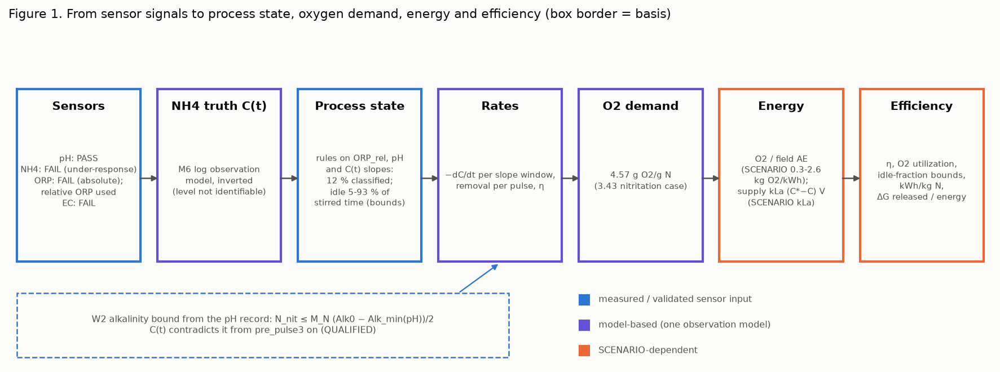
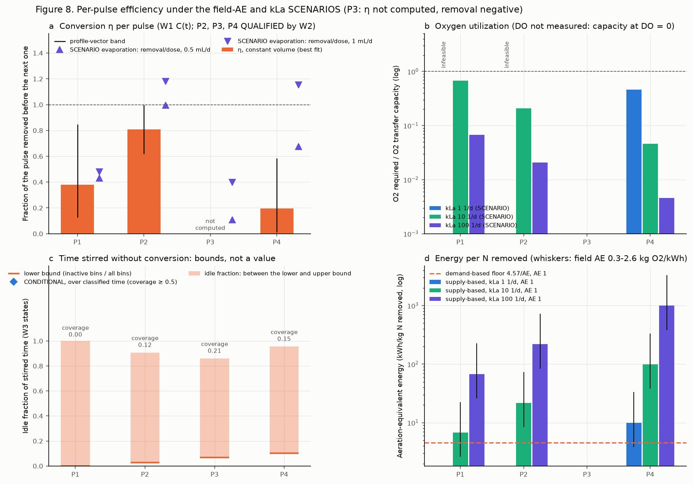
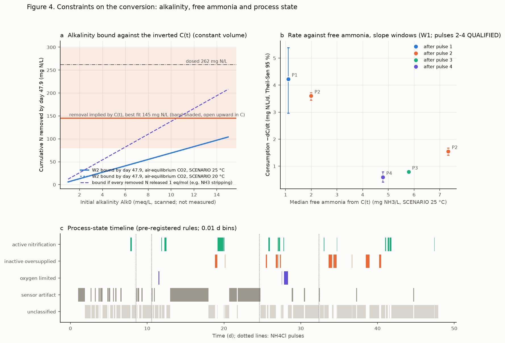
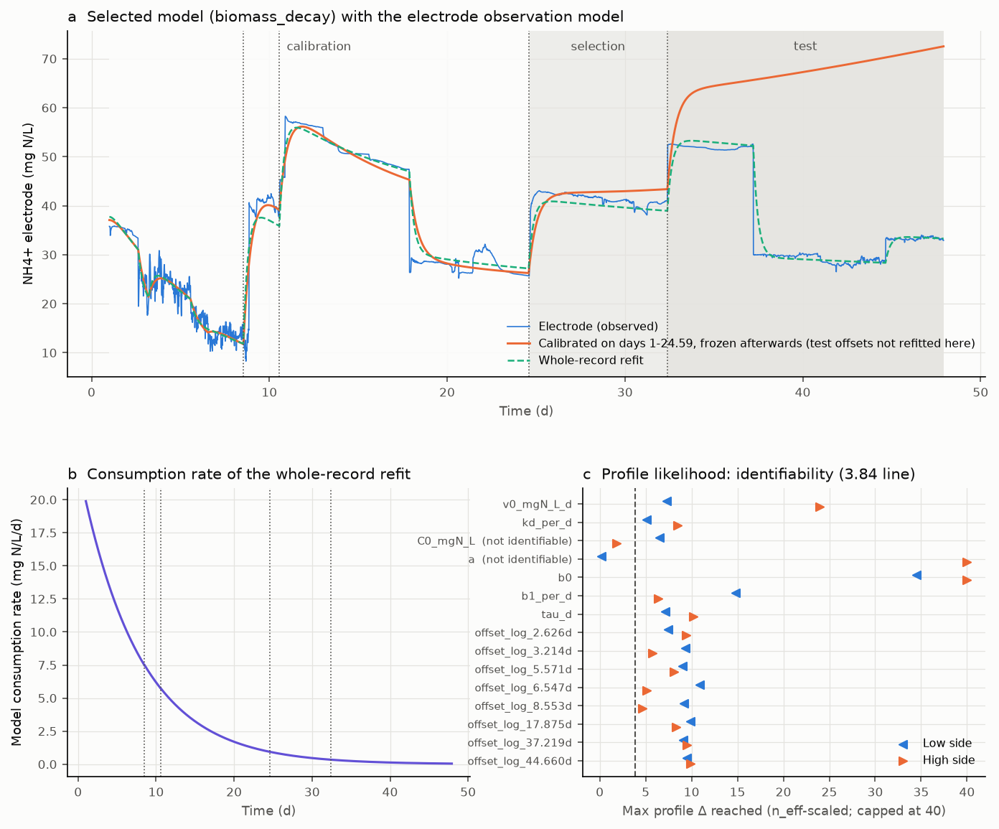
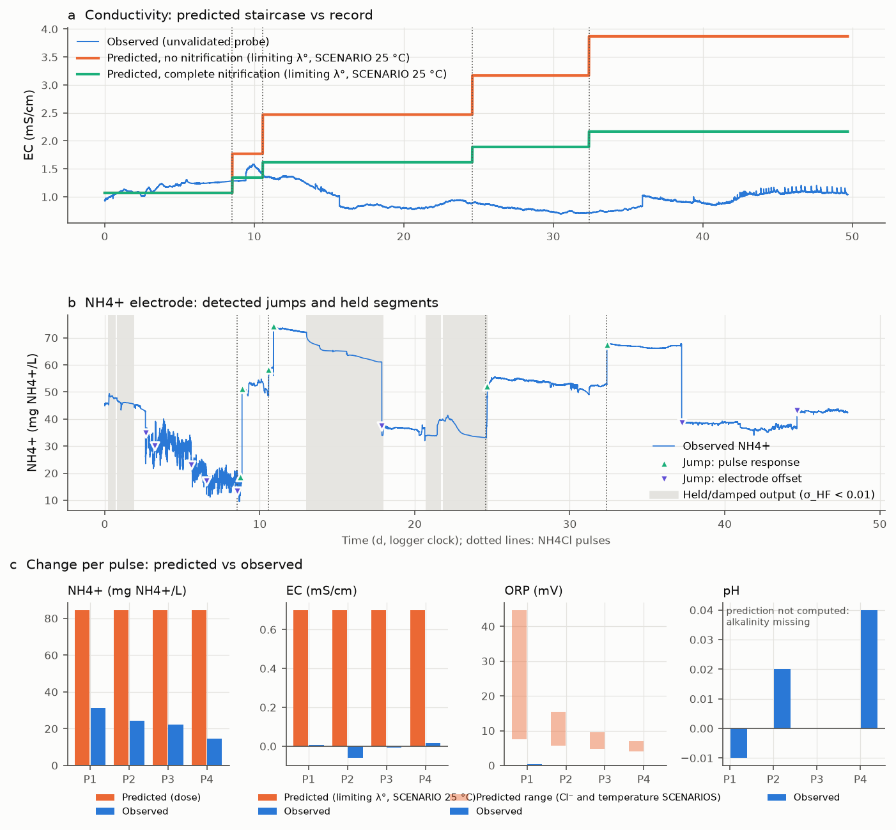
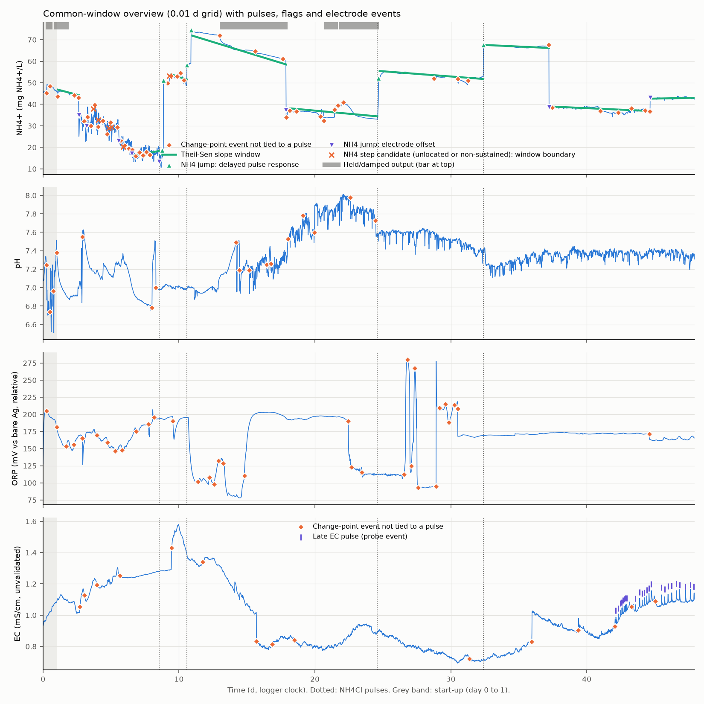
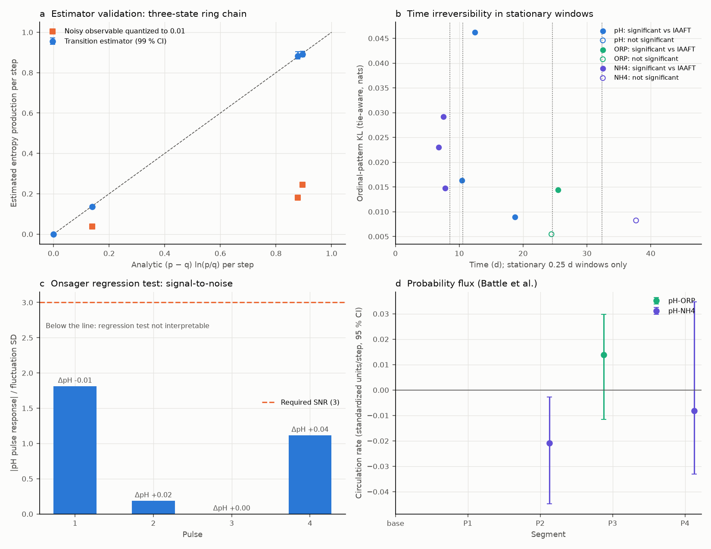
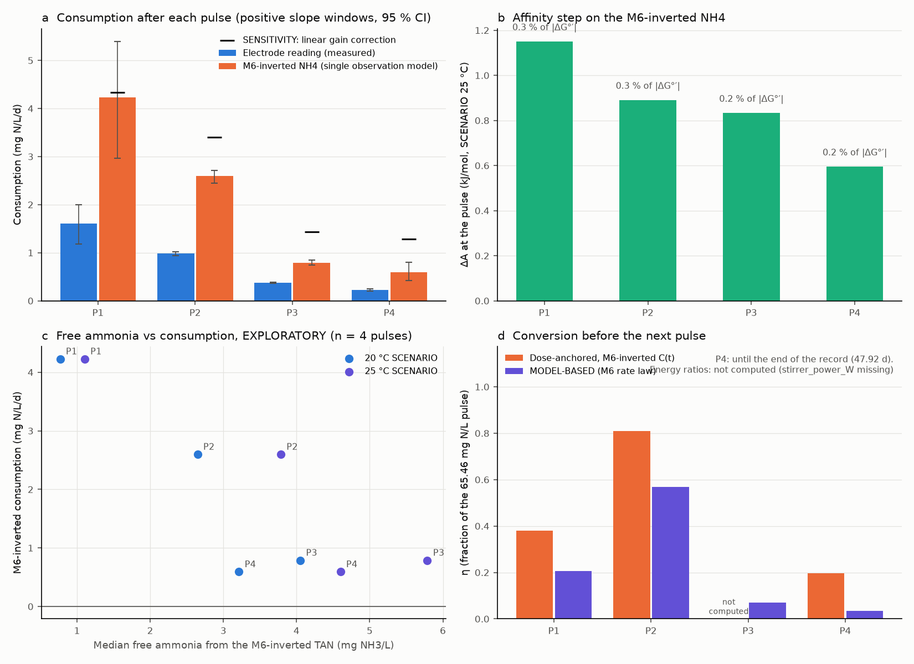

# Non-equilibrium analysis of an NH4Cl-pulsed nitrifying batch

Generated by `python -m bnr_neq run-all` (report stage) from the raw files in `data/`. Do not edit by hand. Implementer's report, not an approval. Labels: SCENARIO = assumed value with its range; MODEL-BASED = from the selected M6 rate law; SENSITIVITY = an alternative NH4 observation model kept for comparison; QUALIFIED = derived from a C(t) that contradicts the W2 alkalinity bound.

## 1. What the data say about the process

1. **Only pH is a validated sensor.** pH: PASS (no contradiction); NH4 electrode: FAIL: under-response, 17 to 37% of the dose; conductivity: FAIL: no response to the pulses; ORP: FAIL: no chloride response at the bare Ag (absolute E_H unusable, relative changes used with a stated assumption).

2. **One NH4 truth.** Every NH4-derived number rests on C(t), the inversion of the M6 log observation model. Its level is not identifiable: 177 mg N/L at day 1 (band 75-282) and 294 at day 47.9 (band 182-357), and the band is open upward over the whole series (the data do not bound the level from above; its upper edge is only the last evaluated profile vector), against an electrode reading of 33 mg N/L at the end.

3. **Alkalinity caps nitrification.** Nothing but NH4Cl was added, so nitrification (2 eq/mol N) is bounded by the initial alkalinity and the pH record: by day 47.9 at most 34 mg N/L for Alk0 = 5 meq/L and 104 mg N/L for 15 meq/L, against 262 mg N/L dosed. Unless Alk0 was high, most of the dose stayed as TAN, with free ammonia of at least 2.4-3.9 mg NH3/L at the end (SCENARIO 25 °C).

4. **The inverted C(t) and the bound disagree (S2).** The best-fit C(t) implies 145 mg N/L removed by the end, which needs Alk0 ≥ 20.9 meq/L if nitrified (scan 1-15). It is consistent only if the true level lies in the open upper part of the band (≥ 11.5 meq/L there), if Alk0 exceeds 15 meq/L, or if a sink releasing 1 eq/mol N (NH3 stripping from the open, stirred vessel; ≥ 10.5 meq/L) took part. Every C(t)-derived number from pulse 2 on is therefore QUALIFIED (`w2_bound_check`).

5. **Conversion per pulse and dose-removal time.** η = P1 0.38, P2 0.81, P3 n.c., P4 0.20 (fraction of each dose removed before the next; n.c. = not computed, e.g. a negative removal on C(t) or a removal above the dose). The time to remove one dose at the post-pulse rate (a ratio of observed quantities, not a fitted relaxation constant), relative to the pulse interval, was P1 7.6, P2 1.8, P3 10.6, P4 7.1; every dose arrived before the previous one could be removed at that rate, so, on the QUALIFIED C(t) (pulses 2, 3, 4 contradict the W2 bound, point 4), TAN accumulated and the batch was driven away from its inactive reference. The MODEL-BASED η of the selected rate law is P1 0.205, P2 0.569, P3 0.070, P4 0.035, against a dose-anchored removal per dose of P1 0.38, P2 0.81, P3 n.c., P4 0.20. Both use the same observation model, and the model state obeys its own mass balance, so the difference is the decline over each interval of the misfit between the inverted C(t) and the simulated state, per dose: P1 0.17, P2 0.24, P3 -0.25, P4 0.16 (`eta_gap_inversion_misfit_MODEL_BASED`). The rate law does not follow the fast post-pulse fall of the reading (its residuals are strongly autocorrelated), and the inversion assigns that misfit to removal; neither value is the better estimate while C0 and the intercept are not identifiable.

6. **Process state.** Pre-registered rules give a state to 12 % of the record (6 % active nitrification, 5 % inactive and over-supplied, 1 % oxygen-limited); the rest is sensor artifact (27 %, mostly held NH4 output) or unclassified (61 %, much of it a C(t) that rises without an N source). Between NH4-free indicator groups, NH4 consumption differs by: pH rising vs not +1.01 mg N/L/d (95 % block bootstrap -0.82 to +2.61); ORP low vs high -0.75 mg N/L/d, interval not computed (a group has fewer than 2 blocks of 101 bins (89 and 66 bins); the point difference is descriptive only). No indicator separates the consumption reliably; these are associations, not causes.

7. **Mechanism.** 9 of 9 calibrations converged under one policy. The split selects **biomass_decay** (selection skill 0.958, test 0.748, forecast 0.863), and the selection holds against every converged start inside Δ < 3.84 of every other candidate (its lowest selection skill 0.958 against their highest, 0.935). Out of sample, biomass_decay is better than alkalinity_FA_SCENARIO_T25C (test 0.641 to 0.644) and alkalinity_FA_SCENARIO_T20C (test 0.639 to 0.646); its ranking against alkalinity_limited (test 0.227 to 0.812) is undetermined, so the data do not discriminate activity decay from substrate-side (alkalinity) limitation. Alk0 of the converged alkalinity candidates 22.6-80.0 meq/L (every converged minimum inside Δ < 3.84), identifiable in none; against the 20.8 meq/L that the C(t) removal needs if nitrified (pre_pulse3, S2): compatible, not a test. With four pulses, time is confounded with activity decay, alkalinity loss, FA and electrode drift (ranges, rankings and Alk0 profiles: §4).

8. **Energy and efficiency.** The transferable energy measure is oxygen: 4.57 g O2 per g N removed, i.e. a floor of 1.76-15.23 kWh/kg N at field aeration efficiencies of 2.6-0.3 kg O2/kWh (SCENARIO). With aeration sized to kLa_O2 = 10 1/d (SCENARIO) and field AE = 1, the energy per kg N removed is P1 6.8, P2 21.9, P3 n.c., P4 99.7 kWh. The idle fraction of stirred time is bounded, not measured: only part of each interval carries a process state, so it lies between the inactive share of all bins and that share plus every bin without a state: P1 0.00-1.00 (coverage 0.00), P2 0.03-0.91 (coverage 0.12), P3 0.07-0.86 (coverage 0.21), P4 0.10-0.96 (coverage 0.15) (lower-upper bound, classified fraction in brackets; the value over classified time is computed only at a coverage ≥ 0.5; Fig. 8c; QUALIFIED from pulse 2 on). Limits of the idle bounds: (a) the autocorrelation-scaled slope interval under-covers, because ρ̂ from 101 detrended points is biased low (synthetic AR(1) check, `states_interval_coverage.csv`): it covers the true slope in 0.85 of the windows at φ = 0.9 instead of 0.95, and in 0.65 at φ = 0.98, whose median ρ̂ (0.91) is nearest the record's median ρ̂ of C(t) (0.93); so some truly flat windows are still called rising or falling, which moves bins from a state of no change to unclassified or active. (b) Both bounds are conditional on the state classification: the lower bound counts only bins classified inactive, and the upper bound counts the active and oxygen-limited bins as not idle (6.9 % of the whole record), so a truly idle bin misclassified as active lowers the upper bound by at most that share, while the lower bound stays conservative.

9. **The closed frame is not established.** Conditional on C(t), N conservation over pulse 3 needs a net water loss of at least 0.31 mL/d; liquid was present at the end, so the loss was below 2.09 mL/d. Vessel masses would settle it. M6 refitted per SCENARIO evaporation rate (every candidate under the same policy and split; SCENARIO, never a primary row; `model_volume_scenario_summary.csv`): 0.25 mL/d: selects biomass_decay, biomass_decay selection skill 0.958 (test 0.752, forecast 0.864), C(t) 179 mg N/L at day 1 (inside the band) and 334 at the end (inside the band); 0.5 mL/d: selects biomass_decay, biomass_decay selection skill 0.957 (test 0.750, forecast 0.862), C(t) 181 mg N/L at day 1 (inside the band) and 388 at the end (above the band); 1 mL/d: selects biomass_decay, biomass_decay selection skill 0.951 (test 0.717, forecast 0.836), C(t) 183 mg N/L at day 1 (inside the band) and 570 at the end (above the band). The selected model (biomass_decay) does not change under any scenario. The primary C(t) and every primary row stay at constant volume; no primary volume scenario is chosen. Every scenario C(t) is the constant-volume C(t) scaled by φ = V0/V(t): in the start and end windows the ratio of the scenario to the constant-volume median C equals the median φ of the same window within |ratio/φ − 1| ≤ 0.05 (end: 0.25 mL/d 1.138 against 1.136; 0.5 mL/d 1.321 against 1.315; 1 mL/d 1.938 against 1.918). The N amount per initial litre, and with it η, is therefore unchanged, and only the concentrations scale by φ; "above the band" at 0.5 and 1 mL/d is the evaporative concentration of a band that is conditional on constant volume, not more N. At the start φ − 1 ≤ 0.011, below the tolerance, so the start window cannot tell scaled from unchanged.

*Figure 1. From sensor signals to process state, oxygen demand, energy and efficiency (W6)*

## 2. Energy and efficiency

The metric family per pulse (constant volume; all rows with inputs and status in `pulses.csv`). SCENARIO ranges: kLa_O2 = 1, 10, 100 1/d (not measured); field (process-water) aeration efficiency AE = 0.3, 1, 2.6 kg O2/kWh (at about 2 mg/L DO, not the clean-water standard SAE; fine pore: 3.6-4.8 in clean water against 0.7-2.6 in process water; metric suffix `AE`, configuration key `sae_field_kgO2_per_kWh`), source: Stenstrom M.K. and Rosso D. (2010) Aeration, lecture notes, UCLA and UC Irvine, 8 Feb 2010, slide 'Efficiency' (p. 56): process-water AE at 2 mg/L DO from 0.3-0.7 kg O2/kWh (coarse bubble, low SRT) to 2.0-2.6 (fine pore, high SRT); range 0.3 to 2.6 = the extremes of that table. Cross-check: Moore L.W. (2021) Biological Wastewater Treatment Training Series no. 11, Aeration Systems, Oak Ridge National Laboratory (references Metcalf & Eddy, 4th ed.): field 1.0-2.3 lb O2/(hp h) = 0.61-1.40 kg O2/kWh at alpha 0.84, DO 2 mg/L. The source's own caveat applies: its table "should not be used as a general guide line and not for design" (Stenstrom and Rosso 2010, p. 55, as read by the reviewer), so these are scenario values only. O2 supply = kLa (C* − DO) V Δt with DO = 0 while DO is not measured, so utilization is a lower bound and the supply-based energy an upper bound; the supply-based energy also divides a capacity at DO = 0 by an AE defined at DO = 2 mg/L, an inconsistency that inflates it further. The demand-based energy (4.57/AE kWh/kg N) is the floor that any aeration system must spend on the N actually removed; the supply-based value adds the aeration spent while the biomass was idle. The stirrer power is a laboratory-specific term (not measured, `stirrer_power_W` missing).

| pulse | η | removal / dose | N removed (mg N) | O2 required (mg O2) | O2 utilization, kLa 1/d | O2 utilization, kLa 10/d | O2 utilization, kLa 100/d | kWh/kg N floor, AE 2.6-0.3 | kWh/kg N supply, AE 1, kLa 1/d | kWh/kg N supply, AE 1, kLa 10/d | kWh/kg N supply, AE 1, kLa 100/d | idle fraction: bounds (coverage) | dose-removal time / pulse interval | ΔG released / aeration energy, AE 1, kLa 10/d | W2 check |
| --- | --- | --- | --- | --- | --- | --- | --- | --- | --- | --- | --- | --- | --- | --- | --- |
| 1 | 0.38 | 0.38 | 2.49 | 11.4 | n.c. | 0.675 | 0.0675 | 1.76-15.23 | n.c. | 6.77 | 67.7 | 0.00-1.00 (0.00) | 7.59 | 1.02 | consistent |
| 2 | 0.809 | 0.809 | 5.3 | 24.2 | n.c. | 0.209 | 0.0209 | 1.76-15.23 | n.c. | 21.9 | 219 | 0.03-0.91 (0.12) | 1.8 | 0.316 | QUALIFIED |
| 3 | n.c. | n.c. | n.c. | n.c. | n.c. | n.c. | n.c. | not computed | n.c. | n.c. | n.c. | 0.07-0.86 (0.21) | 10.6 | n.c. | QUALIFIED |
| 4 | 0.197 | 0.197 | 1.29 | 5.88 | 0.458 | 0.0458 | 0.00458 | 1.76-15.23 | 9.97 | 99.7 | 997 | 0.10-0.96 (0.15) | 7.11 | 0.0694 | QUALIFIED |

*Figure 8. Per-pulse η, oxygen utilization, idle fraction and energy under SCENARIOS (W6)*

## 3. Process state and the constraints on conversion

### Process states (W3)

| state | condition | features |
| --- | --- | --- |
| sensor_artifact | pulse transient (0.1 d), NH4 step region (to resume + 0.1 d), held/damped NH4, ORP electrode event, empty NH4/pH/ORP bin, before day 1 | QC flags |
| active_nitrification | NH4 slope 95 % interval < 0 and pH not rising | nh4_inverted, ph |
| oxygen_limited | NH4 slope interval spans 0, ORP_rel ≤ −15 mV, ORP not rising, pH not rising | nh4_inverted, orp_relative, ph |
| inactive_oversupplied | NH4 slope interval spans 0 and (ORP_rel ≥ +15 mV or pH rising), ORP_rel not ≤ −15 mV | nh4_inverted, orp_relative, ph |
| unclassified | slope window crosses an artifact, NH4 rising (no N source), consumption with a rising pH, or no indicator beyond its threshold | - |

Idle fraction per interval as bounds with its coverage (`classified_fraction`); the CONDITIONAL value over classified time only where the coverage is ≥ 0.5 (`status`). Limits of the idle bounds: (a) the autocorrelation-scaled slope interval under-covers, because ρ̂ from 101 detrended points is biased low (synthetic AR(1) check, `states_interval_coverage.csv`): it covers the true slope in 0.85 of the windows at φ = 0.9 instead of 0.95, and in 0.65 at φ = 0.98, whose median ρ̂ (0.91) is nearest the record's median ρ̂ of C(t) (0.93); so some truly flat windows are still called rising or falling, which moves bins from a state of no change to unclassified or active. (b) Both bounds are conditional on the state classification: the lower bound counts only bins classified inactive, and the upper bound counts the active and oxygen-limited bins as not idle (6.9 % of the whole record), so a truly idle bin misclassified as active lowers the upper bound by at most that share, while the lower bound stays conservative.

| interval | n_bins | fraction_active_nitrification | fraction_inactive_oversupplied | fraction_oxygen_limited | fraction_sensor_artifact | fraction_unclassified | classified_fraction | idle_fraction_lower_bound | idle_fraction_upper_bound | idle_fraction_of_classified_time | status |
| --- | --- | --- | --- | --- | --- | --- | --- | --- | --- | --- | --- |
| before pulse 1 | 753 | 0.023 | 0 | 0 | 0.3 | 0.68 | 0.023 | 0 | 0.98 | NaN | not computed: classified fraction 0.023 below 0.5 (the classified bins are not representative of the interval; see the bounds) |
| pulse 1 | 204 | 0 | 0 | 0 | 0.23 | 0.77 | 0 | 0 | 1 | NaN | not computed: no bin with a process state in this interval |
| pulse 2 | 1402 | 0.086 | 0.027 | 0.0064 | 0.64 | 0.24 | 0.12 | 0.027 | 0.91 | NaN | not computed: classified fraction 0.120 below 0.5 (the classified bins are not representative of the interval; see the bounds) |
| pulse 3 | 780 | 0.071 | 0.069 | 0.069 | 0.06 | 0.73 | 0.21 | 0.069 | 0.86 | NaN | not computed: classified fraction 0.209 below 0.5 (the classified bins are not representative of the interval; see the bounds) |
| pulse 4 | 1553 | 0.044 | 0.1 | 0 | 0.021 | 0.83 | 0.15 | 0.1 | 0.96 | NaN | not computed: classified fraction 0.147 below 0.5 (the classified bins are not representative of the interval; see the bounds) |
| whole record | 4692 | 0.056 | 0.054 | 0.013 | 0.27 | 0.61 | 0.12 | 0.054 | 0.93 | NaN | not computed: classified fraction 0.123 below 0.5 (the classified bins are not representative of the interval; see the bounds) |

| comparison | role | diff | ci95_low | ci95_high | n_a | n_b | block_bins | status |
| --- | --- | --- | --- | --- | --- | --- | --- | --- |
| ORP_rel low vs high (pooled) | ASSOCIATION TEST (NH4-free partition; not a cause: time and electrode state are confounded) | -0.75 | NaN | NaN | 89 | 66 | 101 | not computed: a group has fewer than 2 blocks of 101 bins (89 and 66 bins); the point difference is descriptive only |
| ORP_rel low vs high (within pulse intervals) | ASSOCIATION TEST (NH4-free partition; not a cause: time and electrode state are confounded) | -0.748 | NaN | NaN | 89 | 66 | 101 | not computed: a group has fewer than 2 blocks of 101 bins (89 and 66 bins); the point difference is descriptive only |
| pH rising vs not rising (pooled) | ASSOCIATION TEST (NH4-free partition; not a cause: time and electrode state are confounded) | 1.06 | -0.81 | 2.51 | 325 | 1706 | 101 | computed |
| pH rising vs not rising (within pulse intervals) | ASSOCIATION TEST (NH4-free partition; not a cause: time and electrode state are confounded) | 1.01 | -0.816 | 2.61 | 325 | 1706 | 101 | computed |
| active_nitrification vs inactive_oversupplied (pooled) | DESCRIPTIVE (circular: the states are defined with the NH4 slope) | 3.57 | 1.02 | 5.83 | 262 | 252 | 101 | computed |
| active_nitrification vs oxygen_limited (pooled) | DESCRIPTIVE (circular: the states are defined with the NH4 slope) | 3.27 | NaN | NaN | 262 | 63 | 101 | not computed: a group has fewer than 2 blocks of 101 bins (262 and 63 bins); the point difference is descriptive only |
| oxygen_limited vs inactive_oversupplied (pooled) | DESCRIPTIVE (circular: the states are defined with the NH4 slope) | 0.299 | NaN | NaN | 63 | 252 | 101 | not computed: a group has fewer than 2 blocks of 101 bins (63 and 252 bins); the point difference is descriptive only |

| phi | n_points | n_windows | nominal | coverage_unscaled | coverage_scaled_estimated_rho | coverage_scaled_true_rho | mean_rho_hat | median_rho_hat |
| --- | --- | --- | --- | --- | --- | --- | --- | --- |
| 0.5 | 101 | 600 | 0.95 | 0.75 | 0.932 | 0.953 | 0.457 | 0.464 |
| 0.9 | 101 | 600 | 0.95 | 0.365 | 0.853 | 0.943 | 0.839 | 0.848 |
| 0.95 | 101 | 600 | 0.95 | 0.272 | 0.797 | 0.945 | 0.876 | 0.884 |
| 0.98 | 101 | 600 | 0.95 | 0.198 | 0.653 | 0.968 | 0.896 | 0.907 |

### Alkalinity bound (W2) and the inverted C(t) (S2)

Air-equilibrium CO2 (conservative), constant volume, SCENARIO 25 °C. Alk0 source: not computed: initial_alkalinity_meq_L missing; only the 1-15 meq/L scan is reported. Temperature, CO2-transfer and volume scenarios: `alkalinity_bound.csv`, `alkalinity.md`.

| alk0_meq_L | consistent_with_pH_record | n_nit_max_end_mgN_L | n_nit_max_fraction_of_dose | n_removed_max_any_proton_sink_end_mgN_L | tan_residual_min_end_mgN_L | fa_residual_min_end_mgNH3_L |
| --- | --- | --- | --- | --- | --- | --- |
| 1 | True | 6.01 | 0.0229 | 12 | 256 | 3.93 |
| 2 | True | 13 | 0.0497 | 26 | 249 | 3.82 |
| 3 | True | 20 | 0.0764 | 40 | 242 | 3.72 |
| 4 | True | 27 | 0.103 | 54 | 235 | 3.61 |
| 5 | True | 34 | 0.13 | 68 | 228 | 3.5 |
| 6 | True | 41 | 0.157 | 82 | 221 | 3.39 |
| 7 | True | 48 | 0.183 | 96.1 | 214 | 3.29 |
| 8 | True | 55 | 0.21 | 110 | 207 | 3.18 |
| 9 | True | 62 | 0.237 | 124 | 200 | 3.07 |
| 10 | True | 69 | 0.264 | 138 | 193 | 2.96 |
| 11 | True | 76 | 0.29 | 152 | 186 | 2.86 |
| 12 | True | 83 | 0.317 | 166 | 179 | 2.75 |
| 13 | True | 90 | 0.344 | 180 | 172 | 2.64 |
| 14 | True | 97.1 | 0.371 | 194 | 165 | 2.53 |
| 15 | True | 104 | 0.397 | 208 | 158 | 2.42 |

| checkpoint | t_d | C_inv_mgN_L | removed_per_initial_litre_mgN_L | removed_band_low_mgN_L | removed_band_high_mgN_L | alk0_required_if_nitrified_meq_L | alk0_required_if_nitrified_band_min_meq_L | alk0_required_any_proton_sink_meq_L | consistent_at_best_fit | verdict |
| --- | --- | --- | --- | --- | --- | --- | --- | --- | --- | --- |
| pre_pulse1 | 8.52 | 111 | 66.3 | 13.5 | 199 | 9.53 | 1.98 | 4.79 | True | consistent: the removal needs Alk0 ≥ 9.5 meq/L if nitrified |
| pre_pulse2 | 10.6 | 151 | 91.2 | 23.7 | 245 | 13.1 | 3.44 | 6.57 | True | consistent: the removal needs Alk0 ≥ 13.1 meq/L if nitrified |
| pre_pulse3 | 24.6 | 164 | 144 | 73.2 | 302 | 20.8 | 10.7 | 10.5 | False | QUALIFIED: contradicts the W2 bound for every scanned Alk0 (1-15 meq/L) at the best fit (needs ≥ 20.8 meq/L if nitrified); consistent only within the open upper part of the C(t) parameter band (≥ 10.7 meq/L there), or with a 1 eq/mol N sink (≥ 10.5 meq/L), or if Alk0 > 15 meq/L |
| pre_pulse4 | 32.4 | 241 | 132 | 62 | 291 | 19 | 9 | 9.6 | False | QUALIFIED: contradicts the W2 bound for every scanned Alk0 (1-15 meq/L) at the best fit (needs ≥ 19.0 meq/L if nitrified); consistent only within the open upper part of the C(t) parameter band (≥ 9.0 meq/L there), or with a 1 eq/mol N sink (≥ 9.6 meq/L), or if Alk0 > 15 meq/L |
| end | 47.9 | 294 | 145 | 79.6 | 299 | 20.9 | 11.5 | 10.5 | False | QUALIFIED: contradicts the W2 bound for every scanned Alk0 (1-15 meq/L) at the best fit (needs ≥ 20.9 meq/L if nitrified); consistent only within the open upper part of the C(t) parameter band (≥ 11.5 meq/L there), or with a 1 eq/mol N sink (≥ 10.5 meq/L), or if Alk0 > 15 meq/L |

*Figure 4. Alkalinity bound, rate against free ammonia, state timeline (W6)*

### Water volume (W8)

| constraint | bound | value_mL_per_d | band_low_mL_per_d | band_high_mL_per_d | basis |
| --- | --- | --- | --- | --- | --- |
| N conservation over pulse 1 (8.53-10.57 d) | lower | 0 | 0 | 0 | CONDITIONAL on the M6-inverted C(t): smallest net loss for which the amount balance removes N ≥ 0 (no N source) |
| N conservation over pulse 2 (10.57-24.59 d) | lower | 0 | 0 | 0 | CONDITIONAL on the M6-inverted C(t): smallest net loss for which the amount balance removes N ≥ 0 (no N source) |
| N conservation over pulse 3 (24.59-32.39 d) | lower | 0.314 | 0 | 0.453 | CONDITIONAL on the M6-inverted C(t): smallest net loss for which the amount balance removes N ≥ 0 (no N source) |
| N conservation over pulse 4 (32.39-47.92 d) | lower | 0 | 0 | 0 | CONDITIONAL on the M6-inverted C(t): smallest net loss for which the amount balance removes N ≥ 0 (no N source) |
| N conservation over every pulse | lower | 0.314 | 0 | 0.453 | CONDITIONAL on the M6-inverted C(t): max over the pulses |
| liquid present at the last sensor reading | upper | 2.09 | NaN | NaN | experimental facts: V0 / 47.92 d (nothing else was added) |
| flat conductivity record (1.069 to 1.089 mS/cm) | upper | 0.0399 | NaN | NaN | CONDITIONAL on the conductivity probe measuring solution conductivity, which M2 rejected (no response to the pulses); computed (CONDITIONAL; not used: the probe failed M2) |
| scenario check: constant volume (closed-frame assumption) | scenario | 0 | NaN | NaN | INCONSISTENT with the constraints: net loss 0 mL/d < N-conservation minimum 0.314 and < liquid-present maximum 2.09 mL/d (the N-conservation constraint is CONDITIONAL on C(t)) |
| scenario check: SCENARIO evaporation 0.25 mL/d | scenario | 0.25 | NaN | NaN | INCONSISTENT with the constraints: net loss 0.25 mL/d < N-conservation minimum 0.314 and < liquid-present maximum 2.09 mL/d (the N-conservation constraint is CONDITIONAL on C(t)) |
| scenario check: SCENARIO evaporation 0.5 mL/d | scenario | 0.5 | NaN | NaN | consistent with the constraints: net loss 0.5 mL/d ≥ N-conservation minimum 0.314 and < liquid-present maximum 2.09 mL/d (the N-conservation constraint is CONDITIONAL on C(t)) |
| scenario check: SCENARIO evaporation 1 mL/d | scenario | 1 | NaN | NaN | consistent with the constraints: net loss 1 mL/d ≥ N-conservation minimum 0.314 and < liquid-present maximum 2.09 mL/d (the N-conservation constraint is CONDITIONAL on C(t)) |

## 4. Reduced model and mechanism (M6, W5)

Convergence policy (one for every candidate): 4 starts per candidate, the default kinetic start multiplied by 0.5, 1, 2, 4 (Alk0 5, 10, 20, 40 meq/L), observation parameters at their default start; at most 8000 function evaluations per start; scipy least_squares (trf) default tolerances, converged = status > 0; the calibration is the converged start with the lowest RSS; the whole-record refit of the selected model has the same budget. A candidate whose calibration did not converge is excluded from selection (`selection_status`); its skills stay in the table and are not comparable.

| model | n_params_calibration | cal_converged | cal_status | cal_nfev | selection_status | sel_skill_vs_null | test_skill_vs_null | forecast_skill_vs_null | selected |
| --- | --- | --- | --- | --- | --- | --- | --- | --- | --- |
| null_no_consumption | 11 | True | 2 | 72 | reference (not a candidate) | 0 | 0 | 0 | False |
| biomass_decay | 13 | True | 2 | 391 | selected | 0.958 | 0.748 | 0.863 | True |
| haldane_FA_SCENARIO_T20C | 14 | True | 2 | 582 | candidate (converged, not selected) | 0.836 | 0.493 | 0.726 | False |
| combined_SCENARIO_T20C | 15 | True | 2 | 445 | candidate (converged, not selected) | 0.53 | -0.366 | -0.0559 | False |
| haldane_FA_SCENARIO_T25C | 14 | True | 2 | 707 | candidate (converged, not selected) | 0.838 | 0.495 | 0.727 | False |
| combined_SCENARIO_T25C | 15 | True | 2 | 424 | candidate (converged, not selected) | 0.526 | -0.376 | -0.0638 | False |
| alkalinity_limited | 13 | True | 2 | 4884 | candidate (converged, not selected) | -0.908 | 0.227 | 0.443 | False |
| alkalinity_FA_SCENARIO_T20C | 15 | True | 2 | 25249 | candidate (converged, not selected) | 0.792 | 0.642 | 0.802 | False |
| alkalinity_FA_SCENARIO_T25C | 15 | True | 2 | 26955 | candidate (converged, not selected) | 0.793 | 0.644 | 0.803 | False |

Bound-constrained calibrations (`cal_at_bounds`: a free parameter within 0.001 x its bound width of a bound, in the fitted coordinates): biomass_decay (C0_mgN_L); haldane_FA_SCENARIO_T20C (Ks_mgNH3_L, a); combined_SCENARIO_T20C (Ks_mgNH3_L, C0_mgN_L, a); haldane_FA_SCENARIO_T25C (a); combined_SCENARIO_T25C (Ks_mgNH3_L, C0_mgN_L, a). A bound, not the data, fixes at least one parameter of these calibrations, so their natural-unit kinetic parameters are not estimates; their skills are what the comparison uses, and no bound was changed to clear a flag. The reference null_no_consumption (no kinetic parameter) has a at a bound. The identifiability of the selected model (biomass_decay) is that of its whole-record refit (profile likelihood), not of this calibration.

Skill range over each candidate's converged starts inside Δ < 3.84 of its calibration (Δ = n_eff ln(RSS/RSS of the calibration) on the calibration window, n_eff from the calibration's residuals): these starts cannot be told apart by the calibration window. The ranges are DIAGNOSTIC (the calibration stays the lowest-RSS converged start; no start's skill is used to choose); every start is in `model_calibration_starts.csv`. The selection of biomass_decay holds against every converged start inside Δ < 3.84 of every other candidate (its lowest selection skill 0.958 against the highest of those starts, 0.935). Out of sample, biomass_decay is better than alkalinity_FA_SCENARIO_T25C over all those starts (test 0.747 to 0.748 against 0.641 to 0.644; forecast 0.862 to 0.863 against 0.801 to 0.803). Out of sample, biomass_decay is better than alkalinity_FA_SCENARIO_T20C over all those starts (test 0.747 to 0.748 against 0.639 to 0.646; forecast 0.862 to 0.863 against 0.799 to 0.804). The out-of-sample ranking of biomass_decay against alkalinity_limited is undetermined (test 0.747 to 0.748 against 0.227 to 0.812; forecast 0.862 to 0.863 against 0.443 to 0.921). The data therefore do not discriminate activity decay from substrate-side (alkalinity) limitation. Per candidate (the ranking of the selected model by the same rule: better or worse only where the two ranges are disjoint, else undetermined; Alk0 minima: every distinct converged minimum inside Δ < 3.84):

| candidate | converged | starts inside Δ < 3.84 | selection skill | test skill | forecast skill | biomass_decay against it (test; forecast) | Alk0 minima inside Δ < 3.84 (meq/L) | cal_at_bounds |
| --- | --- | --- | --- | --- | --- | --- | --- | --- |
| null_no_consumption | True | 1 | 0.000 | 0.000 | 0.000 | reference |  | a |
| biomass_decay | True | 3 | 0.958 | 0.747 to 0.748 | 0.862 to 0.863 | selected |  | C0_mgN_L |
| haldane_FA_SCENARIO_T20C | True | 4 | 0.836 to 0.837 | 0.493 to 0.494 | 0.726 to 0.727 | better; better |  | Ks_mgNH3_L; a |
| combined_SCENARIO_T20C | True | 4 | 0.529 to 0.530 | -0.369 to -0.366 | -0.058 to -0.056 | better; better |  | Ks_mgNH3_L; C0_mgN_L; a |
| haldane_FA_SCENARIO_T25C | True | 4 | 0.838 | 0.494 to 0.495 | 0.727 | better; better |  | a |
| combined_SCENARIO_T25C | True | 4 | 0.526 | -0.376 to -0.375 | -0.064 to -0.063 | better; better |  | Ks_mgNH3_L; C0_mgN_L; a |
| alkalinity_limited | True | 3 | -0.908 to 0.935 | 0.227 to 0.812 | 0.443 to 0.921 | undetermined; undetermined | 22.6; 80.0 |  |
| alkalinity_FA_SCENARIO_T20C | True | 4 | 0.789 to 0.795 | 0.639 to 0.646 | 0.799 to 0.804 | better; better | 23.7 |  |
| alkalinity_FA_SCENARIO_T25C | True | 3 | 0.790 to 0.793 | 0.641 to 0.644 | 0.801 to 0.803 | better; better | 23.7 |  |

Fitted initial alkalinity of the alkalinity candidates (calibration window, conditional on each model) against the Alk0 that the removal implied by C(t) needs (S2, `nh4_truth_w2_consistency.csv`):

| model | cal_converged | alk0_fitted_meq_L | alk0_ci95_low_meq_L | alk0_ci95_high_meq_L | alk0_profile_status | alk0_converged_minima_inside_95_meq_L | S2 requirement at pre_pulse3 (meq/L) | S2 requirement at end (meq/L) | agreement |
| --- | --- | --- | --- | --- | --- | --- | --- | --- | --- |
| alkalinity_limited | True | 80 | NaN | NaN | not identifiable: the profile has more than one minimum below Δ = 3.84 (fitted 80.0 meq/L; other converged minima: Alk0 22.6 meq/L at Δ = 3.01 (2 starts)); no interval; local profile: profile stays below 3.84 on the high side(s) within the bounds or grid | 22.6; 80.0 | 20.8 | 20.9 | compatible, not a test: the fitted value is above the requirement, but the 95 % profile reaches below it or is open |
| alkalinity_FA_SCENARIO_T20C | True | 23.7 | 16.4 | NaN | not identifiable: profile stays below 3.84 on the high side(s) within the bounds or grid; one-sided 95 % lower limit 16.4 meq/L | 23.7 | 20.8 | 20.9 | compatible, not a test: the fitted value is above the requirement, but the 95 % profile reaches below it or is open |
| alkalinity_FA_SCENARIO_T25C | True | 23.7 | 16.3 | NaN | not identifiable: profile stays below 3.84 on the high side(s) within the bounds or grid; one-sided 95 % lower limit 16.3 meq/L | 23.7 | 20.8 | 20.9 | compatible, not a test: the fitted value is above the requirement, but the 95 % profile reaches below it or is open |

M6 per volume SCENARIO (Y7; SCENARIO, never a primary row): every candidate calibrated under the same policy and split with V(t) = V0 − E t (doses, C, the biomass activity and the alkalinity state concentrated by V0/V(t)), and the primary model refitted on the whole record; its C(t) against the constant-volume band (medians over the first and last 0.1 d). M6 refitted per SCENARIO evaporation rate (every candidate under the same policy and split; SCENARIO, never a primary row; `model_volume_scenario_summary.csv`): 0.25 mL/d: selects biomass_decay, biomass_decay selection skill 0.958 (test 0.752, forecast 0.864), C(t) 179 mg N/L at day 1 (inside the band) and 334 at the end (inside the band); 0.5 mL/d: selects biomass_decay, biomass_decay selection skill 0.957 (test 0.750, forecast 0.862), C(t) 181 mg N/L at day 1 (inside the band) and 388 at the end (above the band); 1 mL/d: selects biomass_decay, biomass_decay selection skill 0.951 (test 0.717, forecast 0.836), C(t) 183 mg N/L at day 1 (inside the band) and 570 at the end (above the band). The selected model (biomass_decay) does not change under any scenario. The primary C(t) and every primary row stay at constant volume; no primary volume scenario is chosen. Every scenario C(t) is the constant-volume C(t) scaled by φ = V0/V(t): in the start and end windows the ratio of the scenario to the constant-volume median C equals the median φ of the same window within |ratio/φ − 1| ≤ 0.05 (end: 0.25 mL/d 1.138 against 1.136; 0.5 mL/d 1.321 against 1.315; 1 mL/d 1.938 against 1.918). The N amount per initial litre, and with it η, is therefore unchanged, and only the concentrations scale by φ; "above the band" at 0.5 and 1 mL/d is the evaporative concentration of a band that is conditional on constant volume, not more N. At the start φ − 1 ≤ 0.011, below the tolerance, so the start window cannot tell scaled from unchanged.

| volume_scenario | net_loss_mL_per_d | selected_in_scenario | primary_selected | selected_model_changes | primary_model_sel_skill_vs_null | primary_model_test_skill_vs_null | primary_model_forecast_skill_vs_null | primary_model_cal_converged | whole_record_refit_rmse_log | whole_record_refit_converged | C_start_median_mgN_L | C_start_vs_constant_volume_band | C_end_median_mgN_L | C_end_vs_constant_volume_band | constant_volume_C_start_median_mgN_L | constant_volume_C_end_median_mgN_L | C_start_ratio_to_constant_volume | phi_start_median | C_end_ratio_to_constant_volume | phi_end_median | ratio_within_phi_tolerance |
| --- | --- | --- | --- | --- | --- | --- | --- | --- | --- | --- | --- | --- | --- | --- | --- | --- | --- | --- | --- | --- | --- |
| SCENARIO evaporation 0.25 mL/d | 0.25 | biomass_decay | biomass_decay | False | 0.958 | 0.752 | 0.864 | True | 0.0946 | True | 179 | inside the band | 334 | inside the band | 177 | 294 | 1.01 | 1 | 1.14 | 1.14 | True |
| SCENARIO evaporation 0.5 mL/d | 0.5 | biomass_decay | biomass_decay | False | 0.957 | 0.75 | 0.862 | True | 0.0946 | True | 181 | inside the band | 388 | above the band | 177 | 294 | 1.02 | 1.01 | 1.32 | 1.31 | True |
| SCENARIO evaporation 1 mL/d | 1 | biomass_decay | biomass_decay | False | 0.951 | 0.717 | 0.836 | True | 0.0946 | True | 183 | inside the band | 570 | above the band | 177 | 294 | 1.03 | 1.01 | 1.94 | 1.92 | True |

| volume_scenario | model | cal_converged | sel_skill_vs_null | test_skill_vs_null | forecast_skill_vs_null | selected_in_scenario | selection_status |
| --- | --- | --- | --- | --- | --- | --- | --- |
| SCENARIO evaporation 0.25 mL/d | null_no_consumption | True | 0 | 0 | 0 | False | reference (not a candidate) |
| SCENARIO evaporation 0.25 mL/d | biomass_decay | True | 0.958 | 0.752 | 0.864 | True | selected |
| SCENARIO evaporation 0.25 mL/d | haldane_FA_SCENARIO_T20C | True | 0.817 | 0.477 | 0.684 | False | candidate (converged, not selected) |
| SCENARIO evaporation 0.25 mL/d | combined_SCENARIO_T20C | True | 0.54 | -0.316 | -0.0152 | False | candidate (converged, not selected) |
| SCENARIO evaporation 0.25 mL/d | haldane_FA_SCENARIO_T25C | True | 0.819 | 0.478 | 0.685 | False | candidate (converged, not selected) |
| SCENARIO evaporation 0.25 mL/d | combined_SCENARIO_T25C | True | 0.536 | -0.327 | -0.0244 | False | candidate (converged, not selected) |
| SCENARIO evaporation 0.25 mL/d | alkalinity_limited | True | -0.918 | 0.234 | 0.437 | False | candidate (converged, not selected) |
| SCENARIO evaporation 0.25 mL/d | alkalinity_FA_SCENARIO_T20C | True | 0.795 | 0.657 | 0.812 | False | candidate (converged, not selected) |
| SCENARIO evaporation 0.25 mL/d | alkalinity_FA_SCENARIO_T25C | True | 0.797 | 0.66 | 0.814 | False | candidate (converged, not selected) |
| SCENARIO evaporation 0.5 mL/d | null_no_consumption | True | 0 | 0 | 0 | False | reference (not a candidate) |
| SCENARIO evaporation 0.5 mL/d | biomass_decay | True | 0.957 | 0.75 | 0.862 | True | selected |
| SCENARIO evaporation 0.5 mL/d | haldane_FA_SCENARIO_T20C | True | 0.793 | 0.437 | 0.628 | False | candidate (converged, not selected) |
| SCENARIO evaporation 0.5 mL/d | combined_SCENARIO_T20C | True | 0.548 | -0.282 | 0.0129 | False | candidate (converged, not selected) |
| SCENARIO evaporation 0.5 mL/d | haldane_FA_SCENARIO_T25C | True | 0.794 | 0.437 | 0.629 | False | candidate (converged, not selected) |
| SCENARIO evaporation 0.5 mL/d | combined_SCENARIO_T25C | True | 0.544 | -0.293 | 0.00361 | False | candidate (converged, not selected) |
| SCENARIO evaporation 0.5 mL/d | alkalinity_limited | True | -1.07 | 0.153 | 0.363 | False | candidate (converged, not selected) |
| SCENARIO evaporation 0.5 mL/d | alkalinity_FA_SCENARIO_T20C | True | 0.799 | 0.671 | 0.822 | False | candidate (converged, not selected) |
| SCENARIO evaporation 0.5 mL/d | alkalinity_FA_SCENARIO_T25C | True | 0.799 | 0.671 | 0.821 | False | candidate (converged, not selected) |
| SCENARIO evaporation 1 mL/d | null_no_consumption | True | 0 | 0 | 0 | False | reference (not a candidate) |
| SCENARIO evaporation 1 mL/d | biomass_decay | True | 0.951 | 0.717 | 0.836 | True | selected |
| SCENARIO evaporation 1 mL/d | haldane_FA_SCENARIO_T20C | True | 0.72 | 0.251 | 0.449 | False | candidate (converged, not selected) |
| SCENARIO evaporation 1 mL/d | combined_SCENARIO_T20C | True | 0.576 | -0.227 | 0.0649 | False | candidate (converged, not selected) |
| SCENARIO evaporation 1 mL/d | haldane_FA_SCENARIO_T25C | True | 0.719 | 0.249 | 0.446 | False | candidate (converged, not selected) |
| SCENARIO evaporation 1 mL/d | combined_SCENARIO_T25C | True | 0.569 | -0.246 | 0.0495 | False | candidate (converged, not selected) |
| SCENARIO evaporation 1 mL/d | alkalinity_limited | True | -1.27 | 0.0495 | 0.253 | False | candidate (converged, not selected) |
| SCENARIO evaporation 1 mL/d | alkalinity_FA_SCENARIO_T20C | True | 0.795 | 0.673 | 0.826 | False | candidate (converged, not selected) |
| SCENARIO evaporation 1 mL/d | alkalinity_FA_SCENARIO_T25C | True | 0.795 | 0.673 | 0.826 | False | candidate (converged, not selected) |

Consistency checks of the selected model (true by construction where noted; not findings):

| check | where | value | expected | pass |
| --- | --- | --- | --- | --- |
| pulse adds exactly the dose | 8.53 d | 65.5 | 65.5 | True |
| pulse adds exactly the dose | 10.57 d | 65.5 | 65.5 | True |
| pulse adds exactly the dose | 24.59 d | 65.5 | 65.5 | True |
| pulse adds exactly the dose | 32.39 d | 65.5 | 65.5 | True |
| mass balance closes: C_end − (C0 + pulses − consumed) | whole record | 1.71e-13 | 0 | True |
| consumption rate non-negative | every grid time | 0.0457 | >= 0 | True |
| σ = r A / T ≥ 0 with the coexistence SCENARIO affinity | every grid time | 4.01e-08 | >= 0 | True |
| σ in situ | every grid time (model state C, observed pH) | not computed: DO_mg_L missing | >= 0 | not computed |

| parameter | estimate | ci95_low | ci95_high | identifiable |
| --- | --- | --- | --- | --- |
| v0_mgN_L_d | 20 | 5.01 | 67.3 | True |
| kd_per_d | 0.13 | 0.0356 | 0.233 | True |
| C0_mgN_L | not identifiable | NaN | NaN | False |
| a | not identifiable | NaN | NaN | False |
| b0 | 1.32 | 0.619 | 1.72 | True |
| b1_per_d | -0.000865 | -0.00264 | 0.00142 | True |
| tau_d | 0.262 | 0.165 | 0.394 | True |
| offset_log_2.626d | -0.345 | -0.661 | -0.0497 | True |
| offset_log_3.214d | 0.349 | 0.0463 | 0.711 | True |
| offset_log_5.571d | -0.232 | -0.463 | 0.00982 | True |
| offset_log_6.547d | 0.0233 | -0.212 | 0.343 | True |
| offset_log_8.553d | 0.531 | 0.118 | 0.853 | True |
| offset_log_17.875d | -0.441 | -0.563 | -0.31 | True |
| offset_log_37.219d | -0.571 | -0.673 | -0.471 | True |
| offset_log_44.660d | 0.178 | 0.0724 | 0.283 | True |

*Figure 6. Reduced model with the electrode observation model (M6)*

## 5. Sensor validity

From `sensor_verdicts.csv` (criteria fixed before computing the observations):

| sensor | verdict | criterion |
| --- | --- | --- |
| NH4+ electrode | FAIL: under-response, 17 to 37% of the dose | observed/predicted step within 0.8 to 1.2 for every pulse |
| Conductivity | FAIL: no response to the pulses | observed step ≥ 0.5 x limiting Kohlrausch prediction |
| ORP (Pt vs bare Ag) | FAIL: no chloride response at the bare Ag | observed rise ≥ 0.5 x smallest chloride-scenario prediction |
| pH | PASS (no contradiction) | abs(ΔpH) ≤ 0.05; quantitative prediction not computed: alkalinity_mmol_L missing |

| pulse | nh4_obs_change_mgNH4_L | nh4_response_fraction | ec_obs_change_mS_cm | orp_obs_change_mV | ph_obs_change |
| --- | --- | --- | --- | --- | --- |
| 1 | 31.2 | 0.37 | 0.00516 | 0.4 | -0.01 |
| 2 | 24.5 | 0.29 | -0.0606 | 0 | 0.02 |
| 3 | 22.1 | 0.262 | -0.00667 | 0.125 | 0 |
| 4 | 14.7 | 0.174 | 0.0164 | 0.21 | 0.04 |

*Figure 3. Sensor validation with the known pulses (M2)*

*Figure 2. Common-window overview with pulses, flags and electrode events (M3)*

## 6. Status of the conclusions

| conclusion | status | evidence | missing items / debt |
| --- | --- | --- | --- |
| Upper bound on cumulative nitrification from the pH record (W2) | GO | With Alk0 from 1 to 15 meq/L at most 104 of 262 mg N/L dosed could be nitrified by day 47.9 (air-equilibrium CO2, constant volume, SCENARIO 25 °C). | Assumes no alkalinity source; initial_alkalinity_meq_L missing (scan instead of a value). |
| Single NH4 observation model against the W2 bound (S2) | QUALIFIED | The removal implied by the inverted C(t) needs Alk0 ≥ 20.9 meq/L if nitrified; contradicted at pre_pulse3, pre_pulse4, end Every C(t)-derived row carries `w2_bound_check`. | Blocked by: lab_NH4_N_mg_L, initial_alkalinity_meq_L, NO3_N_mg_L (resolve level, Alk0, sink). |
| Process states from relative ORP, pH and C(t) (W3) | GO WITH DOCUMENTED NON-BLOCKING DEBT | 12 % of the record carries a state (autocorrelation-scaled slope intervals); pH-rising minus non-rising bins +1.01 mg N/L/d (95 % block bootstrap -0.82 to +2.61). | Debt: low coverage (held NH4 output, electrode steps); relative ORP assumes a slowly varying reference. |
| Idle fraction of stirred time (W3 into W4) | BOUNDS ONLY; NO-GO for a single value | Between 5 and 93 % of the stirred time (whole record) at a coverage of 12 % classified; the CONDITIONAL value over classified time: not computed: classified fraction 0.123 below 0.5. | Blocked by: coverage (held NH4 output, electrode steps), DO_mg_L. |
| Model selection, activity decay against alkalinity limitation (M6, W5) | GO WITH DOCUMENTED NON-BLOCKING DEBT | 9 of 9 calibrations converged under one policy; selected biomass_decay; Alk0 of the converged alkalinity candidates 22.6-80.0 meq/L (every converged minimum inside Δ < 3.84); S2 requirement 20.9 meq/L. | Debt: four pulses; time is confounded with decay, alkalinity loss, FA and electrode drift; Alk0 not measured. |
| Oxygen demand and aeration-equivalent energy (W4) | SCENARIO FAMILY COMPUTED; NO-GO for absolute values | O2 demand 4.57 g O2/g N on the removal of C(t); field AE 0.3-2.6 kg O2/kWh and kLa_O2 SCENARIOS; demand floor 1.76-15.23 kWh/kg N. | Blocked by: DO_mg_L, kLa_per_d, temperature_C_measured; QUALIFIED by S2 from pulse 2 on. |
| Closed 100 mL frame (W8) | NO-GO | Conditional on C(t), N conservation needs a net water loss ≥ 0.31 mL/d; evaporation SCENARIOS carried through every balance; M6 refitted per SCENARIO: selected model unchanged (biomass_decay) at 0.25, 0.5, 1 mL/d. | Blocked by: vessel_mass_start_g, vessel_mass_end_g, covered, top_up_mL. |
| Chemical disequilibrium of the batch (coexistence affinity) | CONSISTENCY CHECK (not a finding) | Coexistence SCENARIO affinity 317 kJ/mol (305 to 339 kJ/mol for DO 0.01 to 8 mg/L): computed from assumed concentrations, positive by construction whenever DO > 0. | In situ affinity not computed: DO_mg_L missing (needs DO_mg_L, NO3_N_mg_L). |
| Affinity steps at the pulses | CONSISTENCY CHECK (not a finding) | ΔA = 0.60 to 1.15 kJ/mol on the M6-inverted C(t) (SCENARIO 25 °C; 0.17 to 0.33 % of \|ΔG°′\|); SENSITIVITY reading as TAN 2.36 to 4.17 kJ/mol. A log ratio of concentrations: small by construction for a dose small against the pool. | None blocking. |
| Entropy production σ = r A / T ≥ 0 in the model | CONSISTENCY CHECK (not a finding) | min σ = 4e-08 W/(L K): a non-negative modelled rate times a positive SCENARIO affinity, true by construction. | None blocking. |
| Relative comparison of pulse responses (electrode) | GO WITH DOCUMENTED NON-BLOCKING DEBT | Response fractions 37 %, 29 %, 26 %, 17 % of the dose. | Debt: gain unverified (lab_NH4_N_mg_L missing); delayed responses unexplained (electrode_step_response). |
| Absolute NH4 concentrations, rates and conversion | NO-GO | Electrode registers 17 to 37 % of the dose; C0 and the intercept are not identifiable (2 parameters not identifiable). | Blocked by: lab_NH4_N_mg_L, electrode_step_response, NO3_N_mg_L, NO2_N_mg_L (and recalibration). |
| Conductivity as solution conductivity | NO-GO | Observed pulse responses -0.061 to +0.016 mS/cm against +0.700 predicted (limiting, SCENARIO 25 °C). | Blocked by: probe validation (KCl standard addition, calibrated meter), chloride_mmol_L. |
| Absolute redox potential E_H | NO-GO | ORP response to the chloride added +0.0 to +0.4 mV against 4 to 45 mV per pulse under chloride SCENARIOS. | Blocked by: orp_reference_offset_V, chloride_mmol_L. |
| pH trajectory estimators (supplement S1) | GO WITH DOCUMENTED NON-BLOCKING DEBT | 12 of 187 pH windows stationary; ordinal KL in 3 validated windows (7 outside validated regimes), significant in 3; 28 of 28 required checks pass. | Debt: not connected to rates or energy; Onsager test interpretable for 0 of 4 pulses. |

## 7. Experimental facts and stated assumptions

- Batch of 100 mL, open to air: True, magnetic stirring, no forced aeration.
- Additions: 25 mg NH4Cl at days 8.53, 10.57, 24.59, 32.39 (logger clock); nothing else added or removed.
- NH4 electrode in mg NH4+/L, factor 0.77649 to mg N/L; ORP Pt vs bare Ag.
- Missing measurements: temperature_C_measured, alkalinity_mmol_L, DO_mg_L, kLa_per_d, stirrer_power_W, chloride_mmol_L, orp_reference_offset_V, lab_NH4_N_mg_L, NO3_N_mg_L, NO2_N_mg_L, electrode_step_response, vessel_mass_start_g, vessel_mass_end_g, covered, top_up_mL, initial_alkalinity_meq_L.

1. File headers differ in spelling from implementation_prompt.md Section 4 for Cond.csv, NH4.csv and ORP.csv; the loader maps the headers present in the files and raises on any other (deviation D1).
2. NH4 and ORP timestamps are rounded to 0.01 d; rows sharing a stamp are uniformly spaced within it (t = stamp + 0.01 j/n). The half-sized first stamps suggest round-to-nearest stamps, which would place these times 0.005 d late; not corrected.
3. NH4 values are in mg NH4+/L (experimenter); converted to mg N/L with 0.77649.
4. Conductivity is converted with EC = -2.89855 I + 0.52087 and is not valid as solution conductivity (S3).
5. Temperature is not measured: every temperature-dependent value is a SCENARIO value, at the labelled SCENARIO temperatures 20, 25 °C; values computed with 25 °C constants carry `SCENARIO_T25C` or a `SCENARIO 25 °C` basis; ΔG°′ is a 25 °C value.
6. Kohlrausch predictions use limiting ionic conductivities at 25 °C (SCENARIO; upper bounds at the actual ionic strength).
7. Bare-Ag chloride SCENARIOS use chloride activity = concentration (γ = 1) and equal γ before and after a pulse.
8. C* = 8.26 mg/L (SCENARIO 25 °C) for oxygen; p_O2 = 0.2095 x DO/C*. Ω_CO2 would take [HCO3-] ≈ alkalinity (pH < 8.3).
9. Single NH4 observation model (W1): rates, free ammonia, η, ΔA and O2 demand are derived from C(t) inverted from the M6 log observation model (quasi-static; lag not inverted); a non-positive consumption is not computed and is excluded from duration-weighted rates. Gain-corrected rates (division by the response fraction, linear electrode gain model) and free ammonia from the reading taken as TAN are SENSITIVITY cases.
10. Alkalinity bound (W2): 2 eq per mol N nitrified, no alkalinity source, carbonate equilibria (Plummer and Busenberg 1982) with activities = concentrations, dissolved CO2 at or above air saturation, pH from the 0.11 d rolling median; kLa_CO2 and Alk0 are SCENARIO ranges.
11. Volume (W8): the closed 100 mL frame is an assumption until the vessel masses are measured; evaporation SCENARIOS 0, 0.25, 0.5, 1 mL/d are carried through the balances, the η and the consumption rates (r = −dC/dt + C E/V).
12. Slope windows exclude 0.1 d after every pulse and every NH4 step candidate (located or not, sustained or not) and need ≥ 0.25 d; held/damped NH4 spans inside a window are flagged (`held_fraction`), with a sensitivity slope that removes them.
13. Stationary estimators run only on raw 0.25 d windows passing ADF and KPSS; an index is computed only within its validated tie range and, for pH, only inside matched null regimes whose false-positive rate is at most 0.05 + binomial margin (99 IAAFT surrogates).
14. The M6 model fixes K_NH = 1.0 mg N/L (ASM1), uses offsets at all 8 detected electrode-offset jumps, and refits the test-window offsets as the only nuisance parameters when scoring the test window; the split windows come from the configured pulse times.
15. MODEL-BASED quantities (η, model rates) are conditional on the selected M6 model; C0 and the electrode intercept are not identifiable.
16. Process states (W3): pre-registered rules on the 1.01 d Theil-Sen slopes of C(t), pH and ORP and on ORP relative to its centred 5 d median (±15 mV); the slope intervals are widened by √(n/n_eff) for the lag-1 autocorrelation of each window's residuals; relative ORP assumes a slowly varying bare-Ag reference; QC-flagged bins carry no state. The idle fraction is reported as bounds with the classified fraction (coverage).
17. Energy (W4): kLa_O2 and the field (process-water) aeration efficiency AE are SCENARIO ranges (AE source: Stenstrom M.K. and Rosso D. (2010) Aeration, lecture notes, UCLA and UC Irvine, 8 Feb 2010, slide 'Efficiency' (p. 56): process-water AE at 2 mg/L DO from 0.3-0.7 kg O2/kWh (coarse bubble, low SRT) to 2.0-2.6 (fine pore, high SRT); range 0.3 to 2.6 = the extremes of that table. Cross-check: Moore L.W. (2021) Biological Wastewater Treatment Training Series no. 11, Aeration Systems, Oak Ridge National Laboratory (references Metcalf & Eddy, 4th ed.): field 1.0-2.3 lb O2/(hp h) = 0.61-1.40 kg O2/kWh at alpha 0.84, DO 2 mg/L); the O2 supply is a capacity at DO = 0 while DO is not measured, whereas the AE values are defined at about 2 mg/L DO; stirrer power is a laboratory-specific term only.
18. Model candidates (W5): alkalinity limitation uses the model's own alkalinity state (2 eq/mol N, nothing added) with K_ALK = 0.5 meq/L fixed (ASM3).
19. Electrode fragments (R8): a slope window between two electrode steps (offset jumps, pulse-response jumps or step candidates) shorter than 3 x the longest delayed electrode response is a diagnostic, not a rate, whether or not a pulse governs it; the pulse rates with the fragments are an R8 CASE in `pulses.csv`.

## Supplement S1. Stochastic-thermodynamic and information-theoretic estimators (M5)

Demoted from the main analysis (R6): the pH record is highly tied, few windows are stationary and the NH4 sub-stamp times are reconstructed, so these indices do not connect to rate, energy or efficiency.

| series | role | segment | n_windows | n_stationary | tie_fraction_median | ordinal_kl_windows | ordinal_kl_significant_windows | asym_norm_lag1_significant_windows | hvg_kl_significant_windows |
| --- | --- | --- | --- | --- | --- | --- | --- | --- | --- |
| pH | process | 0 | 30 | 0 | 0.965 | 0 | NaN | NaN | NaN |
| pH | process | 1 | 8 | 1 | 0.896 | 1 | 1 | 0 | 0 |
| pH | process | 2 | 56 | 4 | 0.822 | 2 | 2 | 2 | 2 |
| pH | process | 3 | 31 | 4 | 0.933 | 0 | NaN | NaN | NaN |
| pH | process | 4 | 62 | 3 | 0.938 | 0 | NaN | NaN | NaN |
| ORP | process (relative) | 0 | 30 | 0 | 0.779 | 0 | NaN | NaN | NaN |
| ORP | process (relative) | 1 | 8 | 0 | 0.957 | 0 | NaN | NaN | NaN |
| ORP | process (relative) | 2 | 56 | 1 | 0.927 | 1 | 0 | 0 | 0 |
| ORP | process (relative) | 3 | 29 | 1 | 0.202 | 1 | 1 | 1 | 1 |
| ORP | process (relative) | 4 | 62 | 0 | 0.225 | 0 | NaN | NaN | NaN |
| NH4 | process (offset-corrected, provisional) | 0 | 9 | 3 | 0.561 | 3 | 3 | 3 | 3 |
| NH4 | process (offset-corrected, provisional) | 1 | 4 | 0 | 0.407 | 0 | NaN | NaN | NaN |
| NH4 | process (offset-corrected, provisional) | 2 | 18 | 0 | 0.188 | 0 | NaN | NaN | NaN |
| NH4 | process (offset-corrected, provisional) | 3 | 30 | 0 | 0.12 | 0 | NaN | NaN | NaN |
| NH4 | process (offset-corrected, provisional) | 4 | 59 | 1 | 0.183 | 1 | 0 | 0 | 0 |
| EC | probe behaviour only (S3) | 0 | 30 | 0 | 0.182 | 0 | NaN | NaN | NaN |
| EC | probe behaviour only (S3) | 1 | 8 | 0 | 0.0625 | 0 | NaN | NaN | NaN |
| EC | probe behaviour only (S3) | 2 | 56 | 2 | 0.167 | 2 | 0 | 1 | 2 |
| EC | probe behaviour only (S3) | 3 | 31 | 2 | 0.0278 | 2 | 0 | 2 | 0 |
| EC | probe behaviour only (S3) | 4 | 62 | 4 | 0.0792 | 4 | 3 | 4 | 4 |

| pulse | pulse_response | fluctuation_sd | snr_pulse_response | late_window_stationary | verdict |
| --- | --- | --- | --- | --- | --- |
| 1 | -0.01 | 0.00552 | 1.81 | True | not interpretable: pulse-response SNR 1.81 < 3.0 |
| 2 | 0.02 | 0.107 | 0.187 | False | not interpretable: pulse-response SNR 0.19 < 3.0; not computed: non-stationary late fluctuation window (non-stationary (ADF p >= 0.05 or KPSS p <= 0.05); ADF p 0.059, KPSS p 0.0327) |
| 3 | 0 | 0.0302 | 0 | False | not interpretable: pulse-response SNR 0.00 < 3.0; not computed: non-stationary late fluctuation window (non-stationary (ADF p >= 0.05 or KPSS p <= 0.05); ADF p 0.06, KPSS p 0.1) |
| 4 | 0.04 | 0.0358 | 1.12 | True | not interpretable: pulse-response SNR 1.12 < 3.0 |

**No conclusion about Onsager regression (H4) is drawn**: the pulse-response SNR is insufficient for 4 of 4 pulses (best 1.81 < 3) and the late fluctuation window is non-stationary for 2 of 4.

*Figure 5. Estimator validation, irreversibility, Onsager SNR, probability flux (M5)*

## Supplement S2. Detailed tables

### Verified data properties

| sensor | file | rows_valid | rows_dropped | t_min_d | t_max_d | value_min | value_max | interval_median_s |
| --- | --- | --- | --- | --- | --- | --- | --- | --- |
| cond | Cond.csv | 71759 | 1 | 0.000692521 | 49.6946 | -0.366 | -0.05946 | 59.8337 |
| nh4 | NH4.csv | 414785 | 0 | 0 | 47.92 | 9.52 | 75.13 | 3.03158 |
| orp | ORP.csv | 459884 | 0 | 0 | 53.23 | 77.96 | 318.7 | 10.0465 |
| ph | pH.csv | 414757 | 0 | 0 | 48.0044 | 6.47 | 8.02 | 9.99994 |

### Consumption slopes on the electrode reading (M3; gain-corrected and reading-as-TAN columns are SENSITIVITY)

| sub_segment | fit_start_d | fit_end_d | start_boundary | slope_mgNH4_L_d | held_fraction | consumption_SENSITIVITY_linear_gain_mgN_L_d | status |
| --- | --- | --- | --- | --- | --- | --- | --- |
| 1 | 1.1 | 2.63 | start | -1.67 | 0.524 | NaN | computed |
| 2 | 2.73 | 3.2 | jump (electrode_offset) | NaN | 0 | NaN | not computed: electrode fragment (window between two electrode steps, fit span 0.48 d < 3 x the longest delayed electrode response 0.33 d; slope kept as a diagnostic) |
| 3 | 3.31 | 3.69 | jump (electrode_offset) | NaN | 0 | NaN | not computed: electrode fragment (window between two electrode steps, fit span 0.38 d < 3 x the longest delayed electrode response 0.33 d; slope kept as a diagnostic) |
| 4 | 3.81 | 3.91 | candidate (unlocated, sustained) | NaN | 0 | NaN | not computed: fit span 0.099 d < 0.25 d |
| 5 | 4.18 | 4.82 | candidate (electrode_offset, non-sustained) | NaN | 0 | NaN | not computed: electrode fragment (window between two electrode steps, fit span 0.64 d < 3 x the longest delayed electrode response 0.33 d; slope kept as a diagnostic) |
| 6 | 4.95 | 5 | candidate (unlocated, non-sustained) | NaN | 0 | NaN | not computed: fit span 0.055 d < 0.25 d |
| 7 | 5.19 | 5.57 | candidate (unlocated, non-sustained) | NaN | 0 | NaN | not computed: electrode fragment (window between two electrode steps, fit span 0.38 d < 3 x the longest delayed electrode response 0.33 d; slope kept as a diagnostic) |
| 8 | 5.67 | 5.87 | jump (electrode_offset) | NaN | 0 | NaN | not computed: fit span 0.201 d < 0.25 d |
| 9 | 6.01 | 6.54 | candidate (electrode_offset, non-sustained) | NaN | 0 | NaN | not computed: electrode fragment (window between two electrode steps, fit span 0.53 d < 3 x the longest delayed electrode response 0.33 d; slope kept as a diagnostic) |
| 10 | 6.65 | 8.53 | jump (electrode_offset) | 0.992 | 0 | NaN | computed |
| 11 | 8.63 | 8.55 | pulse 1 | NaN | NaN | NaN | not computed: fit span 0.000 d < 0.25 d |
| 12 | 8.65 | 8.75 | jump (electrode_offset) | NaN | 0 | NaN | not computed: fit span 0.097 d < 0.25 d |
| 13 | 8.85 | 8.82 | jump (pulse_response) | NaN | NaN | NaN | not computed: fit span 0.000 d < 0.25 d |
| 14 | 8.96 | 9.27 | jump (pulse_response) | NaN | 0 | NaN | not computed: electrode fragment (window between two electrode steps, fit span 0.31 d < 3 x the longest delayed electrode response 0.33 d; slope kept as a diagnostic) |
| 15 | 9.39 | 10.6 | candidate (electrode_offset, non-sustained) | -2.07 | 0 | 4.34 | computed |
| 16 | 10.7 | 10.6 | pulse 2 | NaN | NaN | NaN | not computed: fit span 0.000 d < 0.25 d |
| 17 | 10.7 | 10.9 | jump (pulse_response) | NaN | 0 | NaN | not computed: fit span 0.207 d < 0.25 d |
| 18 | 11 | 17.9 | jump (pulse_response) | -1.94 | 0.707 | 5.19 | computed |
| 19 | 18 | 24.6 | jump (electrode_offset) | -0.578 | 0.577 | 1.55 | computed |
| 20 | 24.7 | 24.6 | pulse 3 | NaN | NaN | NaN | not computed: fit span 0.000 d < 0.25 d |
| 21 | 24.8 | 32.4 | jump (pulse_response) | -0.484 | 0 | 1.43 | computed |
| 22 | 32.5 | 32.4 | pulse 4 | NaN | NaN | NaN | not computed: fit span 0.000 d < 0.25 d |
| 23 | 32.5 | 37.2 | jump (pulse_response) | -0.296 | 0 | 1.32 | computed |
| 24 | 37.3 | 44.7 | jump (electrode_offset) | -0.283 | 0 | 1.26 | computed |
| 25 | 44.8 | 47.9 | jump (electrode_offset) | 0.126 | 0 | NaN | computed |

### Slope windows of the inverted C(t) (W1)

| sub_segment | governing_pulse | fit_start_d | fit_end_d | median_C_inv_mgN_L | consumption_mgN_L_d | consumption_ci95_low_mgN_L_d | consumption_ci95_high_mgN_L_d | fa_median_mgNH3_L_SCENARIO_T25C | o2_demand_mgO2_L_d | status |
| --- | --- | --- | --- | --- | --- | --- | --- | --- | --- | --- |
| 1 | NaN | 1.1 | 2.63 | 177 | 4.33 | 3.7 | 5.21 | 0.999 | 19.8 | computed |
| 2 | NaN | 2.73 | 3.2 | 175 | NaN | NaN | NaN | 2.94 | NaN | not computed: electrode fragment (window between two electrode steps, fit span 0.48 d < 3 x the longest delayed electrode response 0.33 d; slope kept as a diagnostic) |
| 3 | NaN | 3.31 | 3.69 | 131 | NaN | NaN | NaN | 1.5 | NaN | not computed: electrode fragment (window between two electrode steps, fit span 0.38 d < 3 x the longest delayed electrode response 0.33 d; slope kept as a diagnostic) |
| 4 | NaN | 3.81 | 3.91 | 152 | NaN | NaN | NaN | 1.5 | NaN | not computed: fit span 0.099 d < 0.25 d |
| 5 | NaN | 4.18 | 4.82 | 136 | NaN | NaN | NaN | 1.34 | NaN | not computed: electrode fragment (window between two electrode steps, fit span 0.64 d < 3 x the longest delayed electrode response 0.33 d; slope kept as a diagnostic) |
| 6 | NaN | 4.95 | 5 | 135 | NaN | NaN | NaN | 1.27 | NaN | not computed: fit span 0.055 d < 0.25 d |
| 7 | NaN | 5.19 | 5.57 | 130 | NaN | NaN | NaN | 1.61 | NaN | not computed: electrode fragment (window between two electrode steps, fit span 0.38 d < 3 x the longest delayed electrode response 0.33 d; slope kept as a diagnostic) |
| 8 | NaN | 5.67 | 5.87 | 129 | NaN | NaN | NaN | 1.71 | NaN | not computed: fit span 0.201 d < 0.25 d |
| 9 | NaN | 6.01 | 6.54 | 123 | NaN | NaN | NaN | 1.33 | NaN | not computed: electrode fragment (window between two electrode steps, fit span 0.53 d < 3 x the longest delayed electrode response 0.33 d; slope kept as a diagnostic) |
| 10 | NaN | 6.65 | 8.53 | 102 | NaN | NaN | NaN | 0.521 | NaN | not computed: non-positive consumption of the M6-inverted NH4 (C(t) rises in the window) |
| 11 | 1 | 8.63 | 8.55 | NaN | NaN | NaN | NaN | NaN | NaN | not computed: fit span 0.000 d < 0.25 d |
| 12 | 1 | 8.65 | 8.75 | 55.4 | NaN | NaN | NaN | 0.369 | NaN | not computed: fit span 0.097 d < 0.25 d |
| 13 | 1 | 8.85 | 8.82 | NaN | NaN | NaN | NaN | NaN | NaN | not computed: fit span 0.000 d < 0.25 d |
| 14 | 1 | 8.96 | 9.27 | 152 | NaN | NaN | NaN | 1.13 | NaN | not computed: electrode fragment (window between two electrode steps, fit span 0.31 d < 3 x the longest delayed electrode response 0.33 d; slope kept as a diagnostic) |
| 15 | 1 | 9.39 | 10.6 | 159 | 4.23 | 2.96 | 5.39 | 1.1 | 19.3 | computed |
| 16 | 2 | 10.7 | 10.6 | NaN | NaN | NaN | NaN | NaN | NaN | not computed: fit span 0.000 d < 0.25 d |
| 17 | 2 | 10.7 | 10.9 | 173 | NaN | NaN | NaN | 1.21 | NaN | not computed: fit span 0.207 d < 0.25 d |
| 18 | 2 | 11 | 17.9 | 190 | 3.6 | 3.45 | 3.72 | 1.99 | 16.5 | computed |
| 19 | 2 | 18 | 24.6 | 173 | 1.55 | 1.41 | 1.67 | 7.33 | 7.09 | computed |
| 20 | 3 | 24.7 | 24.6 | NaN | NaN | NaN | NaN | NaN | NaN | not computed: fit span 0.000 d < 0.25 d |
| 21 | 3 | 24.8 | 32.4 | 240 | 0.789 | 0.738 | 0.845 | 5.79 | 3.61 | computed |
| 22 | 4 | 32.5 | 32.4 | NaN | NaN | NaN | NaN | NaN | NaN | not computed: fit span 0.000 d < 0.25 d |
| 23 | 4 | 32.5 | 37.2 | 291 | NaN | NaN | NaN | 3.82 | NaN | not computed: non-positive consumption of the M6-inverted NH4 (C(t) rises in the window) |
| 24 | 4 | 37.3 | 44.7 | 300 | 0.593 | 0.417 | 0.797 | 4.78 | 2.71 | computed |
| 25 | 4 | 44.8 | 47.9 | 293 | NaN | NaN | NaN | 4.73 | NaN | not computed: non-positive consumption of the M6-inverted NH4 (C(t) rises in the window) |

### Thermodynamics and balances (M4)

| pulse | t_pulse_d | baseline_before_mgNH4_L | baseline_before_mgN_L | dose_mgN_L | delta_A_SENSITIVITY_reading_as_TAN_kJ_mol_SCENARIO_T25C | delta_A_SENSITIVITY_reading_as_TAN_kJ_mol_SCENARIO_T20C | delta_A_fraction_of_dG0_SENSITIVITY_reading_as_TAN_SCENARIO_T25C | role |
| --- | --- | --- | --- | --- | --- | --- | --- | --- |
| 1 | 8.53 | 19.2 | 14.9 | 65.5 | 4.17 | 4.1 | 0.012 | SENSITIVITY: electrode reading taken as TAN (no observation model); the primary ΔA uses the M6-inverted C(t) (pulses.csv, delta_A_kJ_mol_SCENARIO_T*) |
| 2 | 10.6 | 49.3 | 38.3 | 65.5 | 2.47 | 2.43 | 0.00709 | SENSITIVITY: electrode reading taken as TAN (no observation model); the primary ΔA uses the M6-inverted C(t) (pulses.csv, delta_A_kJ_mol_SCENARIO_T*) |
| 3 | 24.6 | 33.1 | 25.7 | 65.5 | 3.14 | 3.08 | 0.009 | SENSITIVITY: electrode reading taken as TAN (no observation model); the primary ΔA uses the M6-inverted C(t) (pulses.csv, delta_A_kJ_mol_SCENARIO_T*) |
| 4 | 32.4 | 52.8 | 41 | 65.5 | 2.36 | 2.33 | 0.00678 | SENSITIVITY: electrode reading taken as TAN (no observation model); the primary ΔA uses the M6-inverted C(t) (pulses.csv, delta_A_kJ_mol_SCENARIO_T*) |

| term | value | unit | basis | volume_scenario |
| --- | --- | --- | --- | --- |
| NH4-N start, electrode (uncorrected), day 0.3-1.3 | 36.5105598 | mg N/L | measured (electrode) | constant volume (closed-frame assumption) |
| NH4-N start, laboratory | not computed: lab_NH4_N_mg_L missing | mg N/L | NaN | constant volume (closed-frame assumption) |
| N added (4 pulses) | 261.8571348451141 | mg N/L | known dose | constant volume (closed-frame assumption) |
| NH4-N end, electrode (uncorrected), day 46.9-47.9 | 33.490013700000006 | mg N/L | measured (electrode) | constant volume (closed-frame assumption) |
| NO3-N end | not computed: NO3_N_mg_L missing | mg N/L | NaN | constant volume (closed-frame assumption) |
| NO2-N end | not computed: NO2_N_mg_L missing | mg N/L | NaN | constant volume (closed-frame assumption) |
| NH3 volatilized through the surface | not computed: kLa_per_d missing | mg N/L | needs a measured surface transfer coefficient | constant volume (closed-frame assumption) |
| N assimilated into biomass | not computed: no biomass measurement (MLVSS is not among the [missing] keys) | mg N/L | NaN | constant volume (closed-frame assumption) |
| N2 / N2O loss (closure term) | not computed: NO3_N_mg_L missing | mg N/L | requires NO3-N and NO2-N | constant volume (closed-frame assumption) |
| Removed from the NH4 pool, electrode (uncorrected) | 264.8776809451141 | mg N/L | derived: start + added − end; NO-GO as an absolute value (S1, S2) | constant volume (closed-frame assumption) |
| Balance closure | not computed: NO3_N_mg_L missing | mg N/L | NaN | constant volume (closed-frame assumption) |
| N added (4 pulses), sum of the concentration steps at each pulse | 275.116486749286 | mg N/L | SCENARIO | SCENARIO evaporation 0.25 mL/d |
| N added (4 pulses), concentration at the end if nothing were removed | 297.05857611470685 | mg N/L | SCENARIO | SCENARIO evaporation 0.25 mL/d |
| Removed from the NH4 pool, electrode (uncorrected), amount basis per initial litre | 268.77322644896407 | mg N/L | derived: (C_start V_start + added − C_end V_end) / V0; NO-GO as an absolute value (S1, S2) | SCENARIO evaporation 0.25 mL/d |
| N added (4 pulses), sum of the concentration steps at each pulse | 290.25430466823633 | mg N/L | SCENARIO | SCENARIO evaporation 0.5 mL/d |
| N added (4 pulses), concentration at the end if nothing were removed | 343.19414789661084 | mg N/L | SCENARIO | SCENARIO evaporation 0.5 mL/d |
| Removed from the NH4 pool, electrode (uncorrected), amount basis per initial litre | 272.6687719528141 | mg N/L | derived: (C_start V_start + added − C_end V_end) / V0; NO-GO as an absolute value (S1, S2) | SCENARIO evaporation 0.5 mL/d |
| N added (4 pulses), sum of the concentration steps at each pulse | 328.4083113335004 | mg N/L | SCENARIO | SCENARIO evaporation 1 mL/d |
| N added (4 pulses), concentration at the end if nothing were removed | 497.8272525572511 | mg N/L | SCENARIO | SCENARIO evaporation 1 mL/d |
| Removed from the NH4 pool, electrode (uncorrected), amount basis per initial litre | 280.4598629605141 | mg N/L | derived: (C_start V_start + added − C_end V_end) / V0; NO-GO as an absolute value (S1, S2) | SCENARIO evaporation 1 mL/d |

| term | value | unit | basis | volume_scenario |
| --- | --- | --- | --- | --- |
| Alkalinity, sampling time not recorded (alkalinity_mmol_L) | not computed: alkalinity_mmol_L missing | mmol/L | NaN | constant volume (closed-frame assumption) |
| Initial alkalinity (W2 key) | not computed: initial_alkalinity_meq_L missing | meq/L | NaN | constant volume (closed-frame assumption) |
| Alk0 used by the W2 bound | not computed: initial_alkalinity_meq_L missing; only the 1-15 meq/L scan is reported | NaN | W2: alkalinity_bound.csv | constant volume (closed-frame assumption) |
| Consumed per fully nitrified pulse | 467.41498569852865 | mg CaCO3/L | 7.14 g CaCO3 per g N | constant volume (closed-frame assumption) |
| Consumed per fully nitrified pulse | 9.340827052328711 | meq/L | NaN | constant volume (closed-frame assumption) |
| Consumed if all added N were nitrified | 1869.6599427941146 | mg CaCO3/L | upper bound from the dose | constant volume (closed-frame assumption) |
| Consumed if all added N were nitrified | 37.363308209314845 | meq/L | NaN | constant volume (closed-frame assumption) |
| Consumed if the electrode-implied removal were nitrified | 1891.2266419481145 | mg CaCO3/L | conditional on the uncorrected electrode balance | constant volume (closed-frame assumption) |
| Remaining alkalinity | not computed: alkalinity_mmol_L missing | mmol/L | NaN | constant volume (closed-frame assumption) |
| CO2 supersaturation Ω_CO2 | not computed: alkalinity_mmol_L missing | - | NaN | constant volume (closed-frame assumption) |
| Consumed if all added N were nitrified, concentration at the end | 42.386055824520525 | meq/L | amount per initial litre x V0/V_end | SCENARIO evaporation 0.25 mL/d |
| Consumed if all added N were nitrified, concentration at the end | 48.96894916030779 | meq/L | amount per initial litre x V0/V_end | SCENARIO evaporation 0.5 mL/d |
| Consumed if all added N were nitrified, concentration at the end | 71.03290534090274 | meq/L | amount per initial litre x V0/V_end | SCENARIO evaporation 1 mL/d |
| Minimum initial alkalinity that can hold the observed pH (air-equilibrium CO2) | 0.6434654841366978 | meq/L | W2: max over t of Alk_min(pH(t)) V(t)/V0; SCENARIO 25 °C | constant volume (closed-frame assumption) |
| Upper bound on cumulative nitrification by the end, Alk0 = 2 meq/L | 13.009538747950954 | mg N/L | W2 bound, air-equilibrium CO2 (conservative), SCENARIO 25 °C; alkalinity_bound.csv | constant volume (closed-frame assumption) |
| Upper bound on cumulative nitrification by the end, Alk0 = 5 meq/L | 34.020038747950956 | mg N/L | W2 bound, air-equilibrium CO2 (conservative), SCENARIO 25 °C; alkalinity_bound.csv | constant volume (closed-frame assumption) |
| Upper bound on cumulative nitrification by the end, Alk0 = 10 meq/L | 69.03753874795096 | mg N/L | W2 bound, air-equilibrium CO2 (conservative), SCENARIO 25 °C; alkalinity_bound.csv | constant volume (closed-frame assumption) |
| Upper bound on cumulative nitrification by the end, Alk0 = 15 meq/L | 104.05503874795096 | mg N/L | W2 bound, air-equilibrium CO2 (conservative), SCENARIO 25 °C; alkalinity_bound.csv | constant volume (closed-frame assumption) |
| Minimum initial alkalinity that can hold the observed pH (air-equilibrium CO2) | 0.6079703193680073 | meq/L | W2: max over t of Alk_min(pH(t)) V(t)/V0; SCENARIO 25 °C | SCENARIO evaporation 0.25 mL/d |
| Upper bound on cumulative nitrification by the end, Alk0 = 2 meq/L | 13.12902213768078 | mg N/L | W2 bound, air-equilibrium CO2 (conservative), SCENARIO 25 °C; alkalinity_bound.csv | SCENARIO evaporation 0.25 mL/d |
| Upper bound on cumulative nitrification by the end, Alk0 = 5 meq/L | 34.13952213768078 | mg N/L | W2 bound, air-equilibrium CO2 (conservative), SCENARIO 25 °C; alkalinity_bound.csv | SCENARIO evaporation 0.25 mL/d |
| Upper bound on cumulative nitrification by the end, Alk0 = 10 meq/L | 69.15702213768078 | mg N/L | W2 bound, air-equilibrium CO2 (conservative), SCENARIO 25 °C; alkalinity_bound.csv | SCENARIO evaporation 0.25 mL/d |
| Upper bound on cumulative nitrification by the end, Alk0 = 15 meq/L | 104.17452213768078 | mg N/L | W2 bound, air-equilibrium CO2 (conservative), SCENARIO 25 °C; alkalinity_bound.csv | SCENARIO evaporation 0.25 mL/d |
| Minimum initial alkalinity that can hold the observed pH (air-equilibrium CO2) | 0.5724751545993166 | meq/L | W2: max over t of Alk_min(pH(t)) V(t)/V0; SCENARIO 25 °C | SCENARIO evaporation 0.5 mL/d |
| Upper bound on cumulative nitrification by the end, Alk0 = 2 meq/L | 13.248505527410606 | mg N/L | W2 bound, air-equilibrium CO2 (conservative), SCENARIO 25 °C; alkalinity_bound.csv | SCENARIO evaporation 0.5 mL/d |
| Upper bound on cumulative nitrification by the end, Alk0 = 5 meq/L | 34.25900552741061 | mg N/L | W2 bound, air-equilibrium CO2 (conservative), SCENARIO 25 °C; alkalinity_bound.csv | SCENARIO evaporation 0.5 mL/d |
| Upper bound on cumulative nitrification by the end, Alk0 = 10 meq/L | 69.27650552741059 | mg N/L | W2 bound, air-equilibrium CO2 (conservative), SCENARIO 25 °C; alkalinity_bound.csv | SCENARIO evaporation 0.5 mL/d |
| Upper bound on cumulative nitrification by the end, Alk0 = 15 meq/L | 104.29400552741059 | mg N/L | W2 bound, air-equilibrium CO2 (conservative), SCENARIO 25 °C; alkalinity_bound.csv | SCENARIO evaporation 0.5 mL/d |
| Minimum initial alkalinity that can hold the observed pH (air-equilibrium CO2) | 0.5014848250619355 | meq/L | W2: max over t of Alk_min(pH(t)) V(t)/V0; SCENARIO 25 °C | SCENARIO evaporation 1 mL/d |
| Upper bound on cumulative nitrification by the end, Alk0 = 2 meq/L | 13.487472306870254 | mg N/L | W2 bound, air-equilibrium CO2 (conservative), SCENARIO 25 °C; alkalinity_bound.csv | SCENARIO evaporation 1 mL/d |
| Upper bound on cumulative nitrification by the end, Alk0 = 5 meq/L | 34.49797230687025 | mg N/L | W2 bound, air-equilibrium CO2 (conservative), SCENARIO 25 °C; alkalinity_bound.csv | SCENARIO evaporation 1 mL/d |
| Upper bound on cumulative nitrification by the end, Alk0 = 10 meq/L | 69.51547230687025 | mg N/L | W2 bound, air-equilibrium CO2 (conservative), SCENARIO 25 °C; alkalinity_bound.csv | SCENARIO evaporation 1 mL/d |
| Upper bound on cumulative nitrification by the end, Alk0 = 15 meq/L | 104.53297230687025 | mg N/L | W2 bound, air-equilibrium CO2 (conservative), SCENARIO 25 °C; alkalinity_bound.csv | SCENARIO evaporation 1 mL/d |

### Pulse-level descriptors (M7)

*Figure 7. Pulse-level descriptors (M7)*

| response | descriptor | n | spearman_rho | status | note |
| --- | --- | --- | --- | --- | --- |
| consumption_weighted_mgN_L_d | delta_A_kJ_mol_SCENARIO_T25C | 4 | 1 | EXPLORATORY (n = 4 pulses) | no p-value: with 4 pulses the smallest attainable two-sided p is 0.083 |
| consumption_weighted_mgN_L_d | fa_median_mgNH3_L_SCENARIO_T20C | 4 | -0.8 | EXPLORATORY (n = 4 pulses) | no p-value: with 4 pulses the smallest attainable two-sided p is 0.083 |
| consumption_weighted_mgN_L_d | fa_median_mgNH3_L_SCENARIO_T25C | 4 | -0.8 | EXPLORATORY (n = 4 pulses) | no p-value: with 4 pulses the smallest attainable two-sided p is 0.083 |
| consumption_weighted_mgN_L_d | median_pH | 4 | -0.4 | EXPLORATORY (n = 4 pulses) | no p-value: with 4 pulses the smallest attainable two-sided p is 0.083 |
| consumption_weighted_mgN_L_d | t_pulse_d | 4 | -1 | EXPLORATORY (n = 4 pulses) | no p-value: with 4 pulses the smallest attainable two-sided p is 0.083 |

### Reference values

47 of 55 reproduced within tolerance; the others are explained in `docs/progress.md` and in each milestone report. They are regression checks against the preliminary analysis, not external validation.

| milestone | quantity | reference | obtained | tolerance | pass | note |
| --- | --- | --- | --- | --- | --- | --- |
| M2 | nh4_response_fraction_pct (pulse 1) | 37 | 37.04 | 3 | True | NaN |
| M2 | nh4_response_fraction_pct (pulse 2) | 29 | 29 | 3 | True | NaN |
| M2 | nh4_response_fraction_pct (pulse 3) | 26 | 26.18 | 3 | True | NaN |
| M2 | nh4_response_fraction_pct (pulse 4) | 17 | 17.44 | 3 | True | NaN |
| M2 | nh4_obs_change_mgNH4_L (pulse 1) | 31.1 | 31.23 | 2 | True | NaN |
| M2 | nh4_obs_change_mgNH4_L (pulse 2) | 24.4 | 24.45 | 2 | True | NaN |
| M2 | nh4_obs_change_mgNH4_L (pulse 3) | 22.1 | 22.07 | 2 | True | NaN |
| M2 | nh4_obs_change_mgNH4_L (pulse 4) | 14.7 | 14.7 | 2 | True | NaN |
| M2 | ec_obs_change_mS_cm (pulse 1) | 0.005 | 0.005159 | 0.01 | True | NaN |
| M2 | ec_obs_change_mS_cm (pulse 2) | -0.062 | -0.06058 | 0.01 | True | NaN |
| M2 | ec_obs_change_mS_cm (pulse 3) | -0.007 | -0.006667 | 0.01 | True | NaN |
| M2 | ec_obs_change_mS_cm (pulse 4) | 0.016 | 0.01638 | 0.01 | True | NaN |
| M2 | orp_obs_change_mV (pulse 1) | 0.4 | 0.4 | 0.5 | True | NaN |
| M2 | orp_obs_change_mV (pulse 2) | 0 | 0 | 0.5 | True | NaN |
| M2 | orp_obs_change_mV (pulse 3) | 0.1 | 0.125 | 0.5 | True | NaN |
| M2 | orp_obs_change_mV (pulse 4) | 0.2 | 0.21 | 0.5 | True | NaN |
| M2 | ph_obs_change (pulse 1) | -0.01 | -0.01 | 0.02 | True | NaN |
| M2 | ph_obs_change (pulse 2) | 0.02 | 0.02 | 0.02 | True | NaN |
| M2 | ph_obs_change (pulse 3) | 0 | 0 | 0.02 | True | NaN |
| M2 | ph_obs_change (pulse 4) | 0.04 | 0.04 | 0.02 | True | NaN |
| M2 | ec_median_day_0.3_1.3_mS_cm | 1.069 | 1.069 | 0.005 | True | NaN |
| M2 | ec_median_day_48.5_49.6_mS_cm | 1.071 | 1.071 | 0.005 | True | NaN |
| M2 | nh4_median_start_mgNH4_L | 47.1 | 47.02 | 0.5 | True | NaN |
| M2 | nh4_median_end_mgNH4_L | 43.1 | 43.13 | 0.5 | True | NaN |
| M2 | nh4_offset_jump_day | 2.59 | 2.626 | 0.02 | False | nearest detected offset; detector run onset 2.600 d |
| M2 | nh4_offset_jump_day | 17.84 | 17.88 | 0.02 | False | nearest detected offset; detector run onset 17.850 d |
| M2 | nh4_offset_jump_day | 37.19 | 37.22 | 0.02 | False | nearest detected offset; detector run onset 37.194 d |
| M2 | nh4_offset_jump_day | 44.63 | 44.66 | 0.02 | False | nearest detected offset; detector run onset 44.636 d |
| M2 | nh4_delayed_response_day_pulse1 (pulse 1) | 8.85 | 8.858 | 0.02 | True | largest response to pulse 1; lag 7.88 h |
| M2 | nh4_delayed_response_day_pulse2 (pulse 2) | 10.88 | 10.88 | 0.02 | True | largest response to pulse 2; lag 7.52 h |
| M2 | ec_late_pulse_count | 29 | 29 | 3 | True | median decay 23.1 min (reference about 24 min) |
| M3 | slope_mgNH4_L_d 0.3-2.59 (production sub-segment) | -1.89 | -1.671 | 0.189 | False | fit window 1.100 to 2.625 d; exact window gives -1.914 |
| M3 | slope_mgNH4_L_d 2.59-8.82 (production sub-segment) | -3.42 | 0.9918 | 0.342 | False | fit window 6.647 to 8.530 d; exact window gives -3.406 |
| M3 | slope_mgNH4_L_d 10.85-17.84 (production sub-segment) | -1.95 | -1.939 | 0.195 | True | fit window 10.983 to 17.875 d; exact window gives -1.951 |
| M3 | slope_mgNH4_L_d 17.84-24.6 (production sub-segment) | -0.57 | -0.5784 | 0.057 | True | fit window 17.975 to 24.590 d; exact window gives -0.573 |
| M3 | slope_mgNH4_L_d 24.6-32.36 (production sub-segment) | -0.48 | -0.4837 | 0.05 | True | fit window 24.765 to 32.390 d; exact window gives -0.480 |
| M3 | slope_mgNH4_L_d 32.36-37.19 (production sub-segment) | -0.31 | -0.2963 | 0.05 | True | fit window 32.496 to 37.219 d; exact window gives -0.304 |
| M3 | slope_mgNH4_L_d 37.19-44.63 (production sub-segment) | -0.28 | -0.2832 | 0.05 | True | fit window 37.319 to 44.660 d; exact window gives -0.282 |
| M3 | slope_mgNH4_L_d 44.63-47.92 (production sub-segment) | 0.12 | 0.1256 | 0.05 | True | fit window 44.760 to 47.920 d; exact window gives 0.115 |
| M3 | consumption_SENSITIVITY_linear_gain_mgN_L_d after pulse 2 | 5.2 | 5.191 | 0.52 | True | sub-segment 18 (10.983 to 17.875 d); tolerance: 10 % (reference says 'about') |
| M3 | consumption_SENSITIVITY_linear_gain_mgN_L_d after pulse 4 | 1.4 | 1.319 | 0.14 | True | sub-segment 23 (32.496 to 37.219 d); tolerance: 10 % (reference says 'about') |
| M3 | free ammonia min, day 17.84-32.36, 20/25 C SCENARIOS (mg NH3/L; SENSITIVITY: reading as TAN, as in the preliminary analysis) | 0.7 | 0.7016 | 0.05 | True | range of sub-segment medians; tolerance: rounding of the reference to 0.1 |
| M3 | free ammonia max, day 17.84-32.36, 20/25 C SCENARIOS (mg NH3/L; SENSITIVITY: reading as TAN, as in the preliminary analysis) | 1.2 | 1.168 | 0.05 | True | range of sub-segment medians; tolerance: rounding of the reference to 0.1 |
| M3 | max Lomb-Scargle normalized power (periodicity band) | 0.05 | 0.05157 | 0.01 | True | ORP at 0.346 c/d; full band max 0.628; tolerance: 0.01 (reference says 'about') |
| M4 | delta_A_kJ_mol pulse 1 (SENSITIVITY: reading as TAN, as in the preliminary analysis) | 4.2 | 4.172 | 0.1 | True | NaN |
| M4 | delta_A_kJ_mol pulse 2 (SENSITIVITY: reading as TAN, as in the preliminary analysis) | 2.5 | 2.471 | 0.1 | True | NaN |
| M4 | delta_A_kJ_mol pulse 3 (SENSITIVITY: reading as TAN, as in the preliminary analysis) | 3.1 | 3.138 | 0.1 | True | NaN |
| M4 | delta_A_kJ_mol pulse 4 (SENSITIVITY: reading as TAN, as in the preliminary analysis) | 2.4 | 2.365 | 0.1 | True | NaN |
| M4 | coexistence affinity kJ/mol (documented SCENARIO) | 317 | 316.9 | 2 | True | NaN |
| M4 | HCO3- air-equilibrium mmol/L at pH 7.3 | 0.127 | 0.1268 | 0.001 | True | NaN |
| M4 | HCO3- air-equilibrium mmol/L at pH 7.8 | 0.401 | 0.4011 | 0.001 | True | NaN |
| M4 | O2 demand min mg O2/L/d (SENSITIVITY: linear gain, as in the preliminary analysis) | 6 | 5.763 | 0.6 | True | tolerance 10 % (reference says 'about'); range over slope windows with positive gain-corrected consumption |
| M4 | O2 demand max mg O2/L/d (SENSITIVITY: linear gain, as in the preliminary analysis) | 33 | 23.72 | 3.3 | False | tolerance 10 % (reference says 'about'); range over slope windows with positive gain-corrected consumption |
| M4 | kLa required min 1/d (SENSITIVITY: linear gain, as in the preliminary analysis) | 0.7 | 0.6978 | 0.07 | True | tolerance 10 % (reference says 'about'); range over slope windows with positive gain-corrected consumption |
| M4 | kLa required max 1/d (SENSITIVITY: linear gain, as in the preliminary analysis) | 4 | 2.872 | 0.4 | False | tolerance 10 % (reference says 'about'); range over slope windows with positive gain-corrected consumption |

### Every table

| table (outputs/tables/) | content | rows |
| --- | --- | --- |
| data_properties.csv | M1: measured file properties against Section 4 | 4 |
| dropped_rows.csv | M1: every dropped row with file and line | 1 |
| gaps.csv | M1: gap and missing-sample inventory | 4 |
| grid_coverage.csv | M1: 0.01 d grid coverage per sensor | 4 |
| sensor_validation.csv | M2: predicted and observed response to each pulse | 4 |
| sensor_validation_windows.csv | M2: window medians and sample counts | 32 |
| sensor_balances.csv | M2: cumulative EC and nitrogen balances | 13 |
| sensor_validation_references.csv | M2: reference comparison | 31 |
| sensor_verdicts.csv | M2: sensor verdicts with their a priori criteria | 4 |
| nh4_jumps.csv | M2: NH4 jump candidates, classification and transition times | 20 |
| nh4_held_segments.csv | M2: held/damped NH4 output segments | 5 |
| nh4_hf_residual_subsegments.csv | M2: NH4 high-frequency residual per sub-segment | 9 |
| ec_late_pulses.csv | M2: late conductivity pulses with decay fits | 29 |
| ec_late_pulse_sensitivity.csv | M2: late-pulse count against threshold | 6 |
| clock_check.csv | M2 (corrected in M3): step timing at the day-2.89 multi-probe event | 3 |
| segments.csv | M3: sub-segments, Theil-Sen slopes of the reading, held fraction; linear-gain consumption and reading-as-TAN free ammonia (SENSITIVITY in the column names since W1/X4); R8 electrode fragments | 25 |
| segments_window_check.csv | M3: no slope window contains a pulse or any NH4 step candidate | 9 |
| segments_reference_windows.csv | M3: slopes on the exact preliminary windows (diagnostic) | 8 |
| segments_references.csv | M3: reference comparison | 13 |
| kinetic_fits.csv | M3: zero/first-order, Monod, Haldane fits per segment | 25 |
| kinetic_parameters.csv | M3: kinetic parameters with Jacobian-based identifiability | 50 |
| changepoints.csv | M3: PELT breaks and events | 186 |
| changepoint_sensitivity.csv | M3: PELT break count against penalty | 24 |
| lomb_scargle_summary.csv | M3: Lomb-Scargle maxima per band | 12 |
| thermo_affinity_steps.csv | M4: affinity step at each pulse | 4 |
| thermo_coexistence.csv | M4: coexistence SCENARIO affinity and DO sensitivity | 8 |
| thermo_chloride_scenarios.csv | M4: bare-Ag chloride SCENARIOS | 8 |
| thermo_chloride_observed.csv | M4: observed ORP/pH changes and the oxide alternative | 4 |
| thermo_co2.csv | M4: air-equilibrium bicarbonate | 11 |
| thermo_oxygen.csv | M4: oxygen demand and required kLa under the linear gain model (SENSITIVITY in the names) | 10 |
| balance_nitrogen.csv | M4: nitrogen balance | 20 |
| balance_chloride.csv | M4: chloride balance | 21 |
| balance_alkalinity.csv | M4: alkalinity balance, with the W2 bound and V(t) scenarios | 33 |
| alkalinity_bound.csv | W2: upper bound on cumulative nitrification against Alk0 (1-15 meq/L), residual TAN and FA | 480 |
| alkalinity_references.csv | W2: reference checks of the carbonate and bound functions | 8 |
| volume_scenarios.csv | W8: vessel volume scenarios V(t), pulse doses and the evaporation upper bound | 4 |
| thermo_references.csv | M4: reference comparison | 11 |
| estimator_validation.csv | M5: estimator validation suite, matched-null regimes and gate checks | 142 |
| dynamics.csv | M5: irreversibility and complexity per series and segment | 20 |
| dynamics_windows.csv | M5: per-window stationarity, indices and surrogate p-values | 679 |
| dynamics_onsager.csv | M5: Onsager regression test per pulse | 4 |
| dynamics_onsager_lags.csv | M5: Onsager ratio against lag | 331 |
| dynamics_stability.csv | M5: stability indicators before each pulse (exploratory) | 8 |
| dynamics_flux.csv | M5: probability-flux circulation | 10 |
| dynamics_electrode.csv | M5: electrode-dynamics guard | 1 |
| model_fit.csv | M6/W5: model comparison under one convergence policy: convergence, selection status, out-of-sample skill, fitted Alk0 and its profile interval, skill range over the starts inside Δ < 3.84, free parameters at a bound (`cal_at_bounds`) | 9 |
| model_calibration_starts.csv | X1/Y1: every start of the convergence policy per candidate, its Δ against the calibration and its selection, test and forecast skill (diagnostic), free parameters at a bound | 33 |
| model_identifiability.csv | M6: profile-likelihood identifiability (with one-sided crossings) | 15 |
| model_volume_scenarios.csv | Y7: SCENARIO refit of every candidate per evaporation scenario (convergence, skills, selection); never feeds a primary row | 27 |
| model_volume_scenario_summary.csv | Y7: per evaporation SCENARIO, the selected model and the primary model's refit and C(t) level against the constant-volume band, its ratio to the constant-volume C(t) against φ = V0/V(t); never a primary row | 3 |
| model_checks.csv | M6: mass-balance and σ consistency checks | 8 |
| model_response_fractions.csv | M6: model-implied against observed response fractions | 4 |
| nh4_truth_summary.csv | W1: the single NH4 observation model, its inverted C(t) and band | 17 |
| nh4_truth_vectors.csv | W1: profile parameter vectors whose inversions form the C(t) band | 86 |
| nh4_truth_windows.csv | W1: consumption, free ammonia and O2 demand of the inverted C(t) per slope window | 25 |
| nh4_truth_balance.csv | W1: dose-anchored TAN bound (with the W2 bound) against the inverted C(t) | 20 |
| nh4_truth_w2_consistency.csv | S2: per checkpoint, the Alk0 the C(t)-implied removal needs, and the verdict | 5 |
| volume_constraints.csv | W8: data constraints on the net water loss and the evaporation SCENARIOS checked | 11 |
| states_rules.csv | W3: the pre-registered state rules, thresholds and excluded sensor features | 5 |
| states_fractions.csv | W3: time fraction of each state; idle fraction as bounds with its coverage, and the CONDITIONAL value over classified time where coverage ≥ 0.5 | 6 |
| states_timeline.csv | W3: time-ordered runs of one process state | 113 |
| states_comparison.csv | W3: NH4 consumption between indicator groups, block-bootstrap intervals | 7 |
| states_interval_coverage.csv | Y3: synthetic AR(1) check of the autocorrelation-scaled slope interval (its coverage, i.e. the limit of the idle bounds) | 4 |
| pulses.csv | M7/W4: pulse-level metrics (η, removal, O2, energy family, idle-fraction bounds and coverage) with inputs and status | 352 |
| pulses_associations.csv | M7: exploratory associations | 5 |
| all_references.csv | M8: every reference value of the implementation prompt | 55 |

Milestone reports in `outputs/reports/`: `ingest.md`, `sensor_validation.md`, `segments.md`, `thermo.md`, `alkalinity.md`, `dynamics.md`, `model.md`, `states.md`, `pulses.md`.
